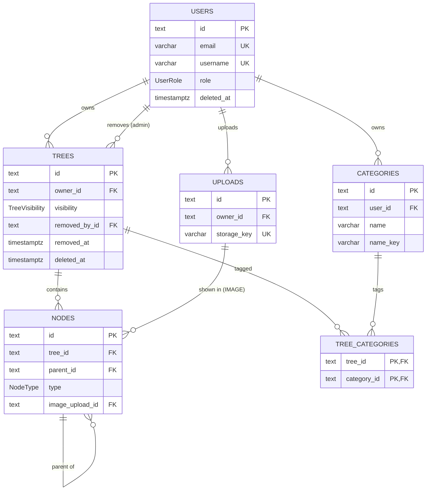

# Highdea Tree — Application Manifest

> Status: Draft (skeleton). Details marked "TBD" will be filled in later phases.
> Section headings carry the Japanese name in parentheses so the manifest-flow skills can find them.

## 1. Project Overview（プロジェクト概要）

**Highdea Tree** is a web app for visualizing ideas so people can organize their thoughts.

- A user starts with **one central idea** ("highdea") and **branches it out** into child ideas, forming a visual tree / mind map.
- Each node can hold anything: **raw text thoughts, website links, videos**, etc.
- Users can **categorize** their idea trees.
- Users can **browse other people's public highdeas** for inspiration.

**Target users:** anyone who wants to think visually — students, creators, developers, planners.
**Problem solved:** linear notes make it hard to see how ideas connect. Highdea Tree makes structure visible.

## 2. User Roles (RBAC)（ユーザーロール定義）

| Role | Description |
|---|---|
| Guest | Not logged in. Can browse public trees only. |
| User | Registered account. Creates and manages their own trees. |
| Admin | Moderates public content. Has no access to private trees. |

| Action | Guest | User | Admin |
|---|---|---|---|
| View public trees | ✅ | ✅ | ✅ |
| Sign up / log in | ✅ | — | — |
| Create / edit / delete own trees & nodes | ❌ | ✅ (own only) | ✅ |
| Manage own categories | ❌ | ✅ | ✅ |
| View others' private trees | ❌ | ❌ | ❌ |
| Remove inappropriate public content | ❌ | ❌ | ✅ |

## 3. Functional Requirements（機能要件）

### 3.1 Authentication
Sign up, log in, log out. Each user has a public profile (username, display name, avatar).

### 3.2 Idea Trees (Boards)
- Create a tree with a title and a **root (center) idea**.
- Each tree has a **visibility**: `PRIVATE` (default) or `PUBLIC`. Only `PUBLIC` trees appear in Explore.
- Edit / delete own trees.
- **Trash:** deleting a tree moves it to the user's Trash. From there it can be restored. Trees in the Trash are permanently deleted automatically **10 days** after they were deleted, along with their nodes and category tags.

### 3.3 Idea Nodes
- Add child nodes branching from any node (rule: every node except the root has exactly one parent).
- Node types: `TEXT` (raw thought), `LINK` (website), `VIDEO` (e.g. YouTube URL, embedded), `IMAGE` (uploaded image).
- For `LINK`, the **backend fetches a preview** (page title + thumbnail) when the URL is saved, and stores it on the node.
- `IMAGE` uploads are stored on local disk (`backend/uploads/`) in development; cloud storage (S3) later. Allowed: PNG, JPEG, WebP, GIF, up to 5 MB.
- Drag nodes to reposition; node positions are saved.
- A tree can have at most **2,000 nodes**.
- **Canvas loading (lazy, like lazy-loaded images):**
  1. The whole tree's skeleton (each node's id, parent, type, title and position) loads in one request, so the layout and connecting lines can be drawn at once.
  2. Only nodes inside the visible area (plus a margin) are drawn. Zoomed out, nodes are shown as dots or short titles; zoomed in, as full cards.
  3. Each node's heavy content (note text, link preview, thumbnail, uploaded image, video embed) is fetched in batches when the node comes into view at a readable zoom level, and cached. Images also use `loading="lazy"`.
- Deleting a node deletes its subtree (with confirmation).

### 3.4 Categories
- Users create their own categories (name + color) and assign them to trees.
- A tree can have **multiple categories** (tag-style).

### 3.5 Explore
- Browse a feed of public trees from all users, filter by category / search by title.
- View a public tree read-only, and view a user's profile with their public trees.

## 4. Screens & Navigation（画面遷移・構成）

| Screen | Path | Purpose |
|---|---|---|
| Landing | `/` | Intro + links to Explore / Sign up |
| Sign up / Log in | `/signup`, `/login` | Authentication |
| My Trees (Dashboard) | `/me` | List own trees, filter by category |
| Tree Editor (canvas) | `/trees/:id/edit` | Visual branching editor |
| Tree Viewer | `/trees/:id` | Read-only view (public or own) |
| Explore | `/explore` | Public trees feed |
| User Profile | `/u/:username` | A user's public trees |
| Trash | `/trash` | Deleted trees, days left before permanent deletion, restore |
| Settings | `/settings` | Profile & category management |

> Details TBD (screen design phase)

## 5. Data Modeling（データモデリング）

Common policies:
- **DB:** PostgreSQL. **ORM:** Prisma 7.10.1. The connection URL lives in `backend/prisma.config.ts`, not in `schema.prisma`.
- **Primary keys:** `cuid` strings (`String @id @default(cuid())`, stored as `TEXT`).
- **State columns:** Prisma `enum` (PostgreSQL enum types): `UserRole`, `TreeVisibility`, `NodeType`.
- **Naming:** Prisma models and fields are `camelCase` (the JSON uses the same). DB tables and columns are plural `snake_case`, mapped with `@map` / `@@map`. **[To confirm]**
- **Timestamps:** `TIMESTAMPTZ(3)`, stored in UTC. The frontend converts them to the viewer's local time. **[To confirm]**
- **Text:** `VARCHAR(n)` where a length limit is a business rule, `TEXT` for free text and URLs.

### 5.1 ER Diagram（ER図）



### 5.2 Table Definitions（テーブル定義）

#### users（ユーザー）

| Column | Type | Constraints | Description |
|---|---|---|---|
| id | TEXT | PK, DEFAULT cuid() | User ID |
| email | VARCHAR(255) | NOT NULL, UNIQUE | Login email, stored in lowercase |
| username | VARCHAR(30) | NOT NULL, UNIQUE | Public handle used in `/u/:username`. Allowed characters: `a-z 0-9 _` |
| display_name | VARCHAR(50) | NOT NULL | Name shown on the profile and on trees |
| password_hash | VARCHAR(255) | NOT NULL | bcrypt hash |
| avatar_url | TEXT | NULL | Profile image URL **[To confirm]** whether avatars use the uploads table |
| role | UserRole | NOT NULL, DEFAULT 'USER' | `USER` / `ADMIN` |
| created_at | TIMESTAMPTZ(3) | NOT NULL, DEFAULT now() | Created at |
| updated_at | TIMESTAMPTZ(3) | NOT NULL | Updated at (set by Prisma `@updatedAt`) |
| deleted_at | TIMESTAMPTZ(3) | NULL | Set when the account is deactivated |

**Business rules and constraints**
- Email and username are unique. Enforced in the **DB** (UNIQUE) and the **app layer** (AuthService lowercases the email and checks the username format before saving).
- `password_hash` is never included in an API response. Enforced in the **app layer**: services always use an explicit `select` without it.
- A deactivated user (`deleted_at` set) can't log in, and their profile and public trees are hidden. Enforced in the **app layer** (AuthService, UserService, ExploreService filter on `deleted_at IS NULL`).
- Only `ADMIN` users can call `/api/admin/*`. Enforced in the **app layer** (role-check middleware).
- Users can't change their own `role` through `PATCH /api/users/me`. Enforced in the **app layer** (the Zod schema doesn't accept `role`).

#### trees（アイデアツリー）

| Column | Type | Constraints | Description |
|---|---|---|---|
| id | TEXT | PK, DEFAULT cuid() | Tree ID |
| owner_id | TEXT | NOT NULL, FK→users.id | Owner |
| title | VARCHAR(100) | NOT NULL | Tree title |
| description | VARCHAR(500) | NULL | Short description, shown on Explore cards |
| visibility | TreeVisibility | NOT NULL, DEFAULT 'PRIVATE' | `PRIVATE` / `PUBLIC` |
| removed_at | TIMESTAMPTZ(3) | NULL | Set when an admin removes the tree |
| removed_by_id | TEXT | NULL, FK→users.id | The admin who removed it |
| removal_reason | VARCHAR(500) | NULL | Removal reason, shown to the owner |
| created_at | TIMESTAMPTZ(3) | NOT NULL, DEFAULT now() | Created at |
| updated_at | TIMESTAMPTZ(3) | NOT NULL | Updated at. Explore sorts by this |
| deleted_at | TIMESTAMPTZ(3) | NULL | Set when the owner deletes the tree |

**Business rules and constraints**
- Only the owner can edit or delete a tree, or change its nodes and categories. Enforced in the **app layer** (TreeService checks `owner_id = current user`).
- A `PRIVATE` tree can only be seen by its owner, and admins can't see it either. Enforced in the **app layer**: TreeService returns 404 (not 403) to anyone else, so the tree's existence isn't revealed.
- Explore and public profiles show only trees where `visibility = 'PUBLIC'`, `removed_at` and `deleted_at` are NULL, and the owner isn't deactivated. Enforced in the **app layer** (ExploreService and UserService).
- Admins can remove only `PUBLIC` trees. Enforced in the **app layer** (AdminService rejects removal of `PRIVATE` trees).
- A removed tree can't be made `PUBLIC` again by its owner. The owner can still view and edit it privately. Enforced in the **app layer** (TreeService). **[To confirm]**
- Creating a tree also creates its root node, in the same transaction. Enforced in the **app layer** (TreeService uses `prisma.$transaction`).
- Editing a node bumps the tree's `updated_at`. Enforced in the **app layer** (NodeService updates the tree in the same transaction).
- A deleted tree (`deleted_at` set) sits in its owner's Trash. Only the owner can see it there or restore it; restoring clears `deleted_at`. Enforced in the **app layer** (TrashService).
- A tree in the Trash is permanently deleted 10 days after `deleted_at`. Enforced in the **app layer**: a daily purge job deletes trees where `deleted_at < now() - 10 days`; the DB then removes their nodes and category tags (`ON DELETE CASCADE`).

#### nodes（アイデアノード）

| Column | Type | Constraints | Description |
|---|---|---|---|
| id | TEXT | PK, DEFAULT cuid() | Node ID |
| tree_id | TEXT | NOT NULL, FK→trees.id | The tree it belongs to |
| parent_id | TEXT | NULL, FK→nodes.id | Parent node. NULL means the root (center idea) |
| type | NodeType | NOT NULL, DEFAULT 'TEXT' | `TEXT` / `LINK` / `VIDEO` / `IMAGE` |
| title | VARCHAR(200) | NOT NULL | The idea in short. For `TEXT` nodes this is the thought itself |
| body | TEXT | NULL | Longer note, allowed on any type |
| url | TEXT | NULL | Required for `LINK` and `VIDEO` |
| preview_title | VARCHAR(300) | NULL | `LINK` only: page title fetched by the server |
| preview_description | VARCHAR(1000) | NULL | `LINK` only: page description fetched by the server |
| preview_image_url | TEXT | NULL | `LINK` only: thumbnail URL fetched by the server |
| preview_fetched_at | TIMESTAMPTZ(3) | NULL | When the preview was last fetched |
| image_upload_id | TEXT | NULL, FK→uploads.id | Required for `IMAGE` |
| position_x | DOUBLE PRECISION | NOT NULL, DEFAULT 0 | Canvas X position |
| position_y | DOUBLE PRECISION | NOT NULL, DEFAULT 0 | Canvas Y position |
| sort_order | INTEGER | NOT NULL, DEFAULT 0 | Order among siblings, used by the d3-hierarchy layout |
| created_at | TIMESTAMPTZ(3) | NOT NULL, DEFAULT now() | Created at |
| updated_at | TIMESTAMPTZ(3) | NOT NULL | Updated at |

**Business rules and constraints**
- Each tree has exactly one root node (`parent_id IS NULL`). Enforced in the **app layer**: TreeService creates it with the tree, and NodeService rejects creating another root or deleting the root. Optional extra: a partial unique index added by raw SQL in the migration, `CREATE UNIQUE INDEX nodes_one_root_per_tree ON nodes(tree_id) WHERE parent_id IS NULL;` (Prisma can't express partial indexes). **[To confirm]**
- A node's parent must belong to the same tree. Enforced in the **app layer** (NodeService).
- A node can't be moved under itself or under one of its own descendants. Enforced in the **app layer** (NodeService walks up the ancestors when `parentId` changes). Moving a node (with its subtree) to another parent in the same tree is allowed; the root can't be moved.
- A node's `type` can be changed. `title` and `body` are kept; fields that don't apply to the new type are cleared in the same update. Enforced in the **app layer** (NodeService).
- Required fields depend on the type. Enforced in the **app layer** (a Zod discriminated union on `type`):
  - `TEXT`: `title` only.
  - `LINK`: `url` (http/https).
  - `VIDEO`: `url` from an allowed provider (YouTube or Vimeo **[To confirm]**).
  - `IMAGE`: `image_upload_id`, pointing to an upload owned by the same user.
- Preview fields are set only by the server after it fetches the link (`POST /api/link-preview` or when a `LINK` node is saved). Clients can't write them directly. Enforced in the **app layer**.
- Deleting a node deletes its whole subtree. Enforced in the **DB** (self-FK `ON DELETE CASCADE`); the UI asks for confirmation first.
- A tree can have at most 2,000 nodes. Enforced in the **app layer**: NodeService counts the tree's nodes and inserts the new one in the same transaction, locking the tree row (`SELECT ... FOR UPDATE`) so two simultaneous adds can't go over the limit.

#### categories（カテゴリ）

| Column | Type | Constraints | Description |
|---|---|---|---|
| id | TEXT | PK, DEFAULT cuid() | Category ID |
| user_id | TEXT | NOT NULL, FK→users.id | Owner |
| name | VARCHAR(50) | NOT NULL | Category name, as the user typed it (e.g. `Work`) |
| name_key | VARCHAR(50) | NOT NULL | `name` trimmed and lowercased (e.g. `work`). Set by the server, never by the client. Used for case-insensitive uniqueness and the Explore filter |
| color | VARCHAR(7) | NOT NULL, DEFAULT '#6B7280' | Hex color, e.g. `#FF8800` |
| created_at | TIMESTAMPTZ(3) | NOT NULL, DEFAULT now() | Created at |
| updated_at | TIMESTAMPTZ(3) | NOT NULL | Updated at |

**Business rules and constraints**
- Category names are unique per user, ignoring upper/lower case ("Work" and "work" are the same). Enforced in the **DB** (UNIQUE(user_id, name_key)), so even simultaneous requests can't create a duplicate, and in the **app layer** (CategoryService sets `name_key` from `name` on every create and rename, and turns a unique violation into `409 CATEGORY_NAME_TAKEN`).
- `color` must be a `#RRGGBB` hex value. Enforced in the **app layer** (Zod regex).
- Only the owner can edit or delete a category. Enforced in the **app layer** (CategoryService).
- **[To confirm]** Categories belong to each user, but Explore filters by `?category=`. Plan: Explore matches on the category **name**, case-insensitive, across all users (lowercase the filter and match `name_key`, which is indexed). The alternative is a shared, global category list.

#### tree_categories（ツリー×カテゴリ 中間テーブル）

| Column | Type | Constraints | Description |
|---|---|---|---|
| tree_id | TEXT | PK, FK→trees.id | Tree |
| category_id | TEXT | PK, FK→categories.id | Category |
| created_at | TIMESTAMPTZ(3) | NOT NULL, DEFAULT now() | When the tag was added |

**Business rules and constraints**
- A tree can have the same category only once. Enforced in the **DB** (composite PK).
- A tree can only use categories owned by the tree's owner. Enforced in the **app layer** (TreeService checks this when setting categories).
- A tree can have at most 10 categories. Enforced in the **app layer** (Zod limit on `categoryIds`).

#### uploads（アップロード画像）

| Column | Type | Constraints | Description |
|---|---|---|---|
| id | TEXT | PK, DEFAULT cuid() | Upload ID |
| owner_id | TEXT | NOT NULL, FK→users.id | Uploader |
| storage_key | VARCHAR(255) | NOT NULL, UNIQUE | Relative path in `backend/uploads/` (an S3 key later) |
| original_name | VARCHAR(255) | NOT NULL | Original file name |
| mime_type | VARCHAR(100) | NOT NULL | e.g. `image/png` |
| size_bytes | INTEGER | NOT NULL | File size |
| created_at | TIMESTAMPTZ(3) | NOT NULL, DEFAULT now() | Uploaded at |

**Business rules and constraints**
- Only image MIME types are accepted, up to a size limit. Enforced in the **app layer** (Multer limits plus a content check). Allowed formats: PNG, JPEG, WebP, GIF. Maximum size: 5 MB.
- The server generates `storage_key` (a cuid plus the file extension). The client's file name is never used as a path. Enforced in the **app layer** (UploadService).
- An upload can't be deleted while a node still uses it. Enforced in the **DB** (FK `ON DELETE RESTRICT`).
- Uploads not used by any node are deleted by a daily cleanup job, with no grace period: any upload with no node pointing to it is deleted, however new it is. Enforced in the **app layer** (a scheduled job, run at a low-traffic time). If the job deletes an image between upload and node save, the node save fails with `404 UPLOAD_NOT_FOUND` and the editor asks the user to upload it again.

### 5.3 Deletion Policy（削除・無効化ポリシー）

| Resource | Policy | Implementation | Related data | Notes |
|---|---|---|---|---|
| User | Deactivate (soft delete) | `users.deleted_at` | Trees, categories and uploads are kept but hidden from everyone | No account-deletion screen yet. **[To confirm]** |
| Tree (owner deletes) | Soft delete → Trash, then hard delete after 10 days | `trees.deleted_at`, then a daily purge job | In the Trash: nodes and tags kept, so restore brings everything back. On purge: nodes and tags deleted (CASCADE); uploaded images become unused and are removed by the uploads cleanup job | Restore with `POST /api/trees/:id/restore` |
| Tree (admin removes) | Hide from public | `trees.removed_at`, `removed_by_id`, `removal_reason` | Owner keeps private access | Kept separate from `deleted_at`, so moderation actions stay auditable |
| Node | Hard delete | `DELETE` | Whole subtree deleted (DB CASCADE). The image file stays until cleanup | Nodes have no history, so a soft delete isn't needed |
| Category | Hard delete | `DELETE` | Its `tree_categories` rows are deleted (CASCADE). Trees stay | |
| Tree–category tag | Hard delete | `DELETE` | — | Changing a tree's categories replaces all its tag rows |
| Upload | Hard delete (by cleanup job) | `DELETE` + remove the file | Blocked while any node uses it (RESTRICT) | |

FK `ON DELETE` rules:
- Links to `users`: `RESTRICT`. Users are only soft-deleted, so a physical delete would mean a mistake.
- `nodes.tree_id`, `nodes.parent_id`, `tree_categories.*`: `CASCADE`. These are owned children.
- `nodes.image_upload_id`: `RESTRICT`.

### 5.4 Prisma Schema（schema.prisma）

```prisma
generator client {
  provider = "prisma-client-js"
}

// Prisma 7: the connection URL (DATABASE_URL) is set in backend/prisma.config.ts, not here.
datasource db {
  provider = "postgresql"
}

enum UserRole {
  USER
  ADMIN
}

enum TreeVisibility {
  PRIVATE
  PUBLIC
}

enum NodeType {
  TEXT
  LINK
  VIDEO
  IMAGE
}

model User {
  id           String    @id @default(cuid())
  email        String    @unique @db.VarChar(255)
  username     String    @unique @db.VarChar(30)
  displayName  String    @map("display_name") @db.VarChar(50)
  passwordHash String    @map("password_hash") @db.VarChar(255)
  avatarUrl    String?   @map("avatar_url")
  role         UserRole  @default(USER)
  createdAt    DateTime  @default(now()) @map("created_at") @db.Timestamptz(3)
  updatedAt    DateTime  @updatedAt @map("updated_at") @db.Timestamptz(3)
  deletedAt    DateTime? @map("deleted_at") @db.Timestamptz(3)

  trees        Tree[]     @relation("TreeOwner")
  removedTrees Tree[]     @relation("TreeRemovedBy")
  categories   Category[]
  uploads      Upload[]

  @@map("users")
}

model Tree {
  id            String         @id @default(cuid())
  ownerId       String         @map("owner_id")
  title         String         @db.VarChar(100)
  description   String?        @db.VarChar(500)
  visibility    TreeVisibility @default(PRIVATE)
  removedAt     DateTime?      @map("removed_at") @db.Timestamptz(3)
  removedById   String?        @map("removed_by_id")
  removalReason String?        @map("removal_reason") @db.VarChar(500)
  createdAt     DateTime       @default(now()) @map("created_at") @db.Timestamptz(3)
  updatedAt     DateTime       @updatedAt @map("updated_at") @db.Timestamptz(3)
  deletedAt     DateTime?      @map("deleted_at") @db.Timestamptz(3)

  owner      User           @relation("TreeOwner", fields: [ownerId], references: [id], onDelete: Restrict)
  removedBy  User?          @relation("TreeRemovedBy", fields: [removedById], references: [id], onDelete: Restrict)
  nodes      Node[]
  categories TreeCategory[]

  @@index([ownerId, deletedAt, updatedAt(sort: Desc)])
  @@index([deletedAt])
  @@index([visibility, removedAt, deletedAt, updatedAt(sort: Desc)])
  @@map("trees")
}

model Node {
  id                 String    @id @default(cuid())
  treeId             String    @map("tree_id")
  parentId           String?   @map("parent_id")
  type               NodeType  @default(TEXT)
  title              String    @db.VarChar(200)
  body               String?
  url                String?
  previewTitle       String?   @map("preview_title") @db.VarChar(300)
  previewDescription String?   @map("preview_description") @db.VarChar(1000)
  previewImageUrl    String?   @map("preview_image_url")
  previewFetchedAt   DateTime? @map("preview_fetched_at") @db.Timestamptz(3)
  imageUploadId      String?   @map("image_upload_id")
  positionX          Float     @default(0) @map("position_x")
  positionY          Float     @default(0) @map("position_y")
  sortOrder          Int       @default(0) @map("sort_order")
  createdAt          DateTime  @default(now()) @map("created_at") @db.Timestamptz(3)
  updatedAt          DateTime  @updatedAt @map("updated_at") @db.Timestamptz(3)

  tree        Tree    @relation(fields: [treeId], references: [id], onDelete: Cascade)
  parent      Node?   @relation("NodeChildren", fields: [parentId], references: [id], onDelete: Cascade)
  children    Node[]  @relation("NodeChildren")
  imageUpload Upload? @relation(fields: [imageUploadId], references: [id], onDelete: Restrict)

  @@index([treeId])
  @@index([parentId, sortOrder])
  @@index([imageUploadId])
  @@map("nodes")
}

model Category {
  id        String   @id @default(cuid())
  userId    String   @map("user_id")
  name      String   @db.VarChar(50)
  nameKey   String   @map("name_key") @db.VarChar(50)
  color     String   @default("#6B7280") @db.VarChar(7)
  createdAt DateTime @default(now()) @map("created_at") @db.Timestamptz(3)
  updatedAt DateTime @updatedAt @map("updated_at") @db.Timestamptz(3)

  user  User           @relation(fields: [userId], references: [id], onDelete: Restrict)
  trees TreeCategory[]

  @@unique([userId, nameKey])
  @@index([nameKey])
  @@map("categories")
}

model TreeCategory {
  treeId     String   @map("tree_id")
  categoryId String   @map("category_id")
  createdAt  DateTime @default(now()) @map("created_at") @db.Timestamptz(3)

  tree     Tree     @relation(fields: [treeId], references: [id], onDelete: Cascade)
  category Category @relation(fields: [categoryId], references: [id], onDelete: Cascade)

  @@id([treeId, categoryId])
  @@index([categoryId])
  @@map("tree_categories")
}

model Upload {
  id           String   @id @default(cuid())
  ownerId      String   @map("owner_id")
  storageKey   String   @unique @map("storage_key") @db.VarChar(255)
  originalName String   @map("original_name") @db.VarChar(255)
  mimeType     String   @map("mime_type") @db.VarChar(100)
  sizeBytes    Int      @map("size_bytes")
  createdAt    DateTime @default(now()) @map("created_at") @db.Timestamptz(3)

  owner User   @relation(fields: [ownerId], references: [id], onDelete: Restrict)
  nodes Node[]

  @@index([ownerId])
  @@map("uploads")
}
```

## 6. API Design（API設計）

Policies:
- REST, JSON, base path `/api`.
- Auth: JWT stored in an **httpOnly cookie** (`Secure`, `SameSite`), set on login and cleared on logout.
- Common response shape: `{ "data": ... }` on success, `{ "error": { "code", "message" } }` on failure.
- Request validation with Zod; shared types between frontend and backend.

| Resource | Main endpoints |
|---|---|
| Auth | `POST /api/auth/signup`, `POST /api/auth/login`, `POST /api/auth/logout`, `GET /api/auth/me` |
| Users | `GET /api/users/:username`, `PATCH /api/users/me` |
| Trees | `GET /api/trees` (mine), `POST /api/trees`, `GET /api/trees/:id`, `PATCH /api/trees/:id`, `DELETE /api/trees/:id` (move to Trash) |
| Trash | `GET /api/trash` (my deleted trees), `POST /api/trees/:id/restore` |
| Nodes | `GET /api/trees/:id/nodes?ids=` (lazy-load node details), `POST /api/trees/:id/nodes`, `PATCH /api/nodes/:id`, `PATCH /api/trees/:id/nodes/positions` (move many nodes at once), `DELETE /api/nodes/:id` |
| Categories | `GET /api/categories`, `POST /api/categories`, `PATCH /api/categories/:id`, `DELETE /api/categories/:id` |
| Explore | `GET /api/explore` (public trees, paginated, `?category=&q=`) |
| Uploads | `POST /api/uploads` (image upload, multipart) |
| Link preview | `POST /api/link-preview` (fetch title/thumbnail for a URL) |
| Admin | `DELETE /api/admin/trees/:id` (remove a public tree) |

> Request/response details TBD (API design phase)

### Endpoint Specs

#### Auth

---
##### **POST /api/auth/signup**

- **Summary（機能概要）:** Creates a new user account, then logs the user in by setting the auth cookie.
- **Authorization（認可）:** Guest only (not logged in). A logged-in user must log out before creating another account; a request with a valid auth cookie is rejected with `403`.

**Request（リクエスト）**

- **Body**

| Name | Type | Required | Description |
|---|---|---|---|
| `email` | `String` | ✅ | Login email. Trimmed and lowercased before saving. Valid email format, max 255 characters |
| `username` | `String` | ✅ | Public handle used in `/u/:username`. Lowercased before saving. 3–30 characters, only `a-z 0-9 _` |
| `displayName` | `String` | ✅ | Name shown on the profile and trees. Trimmed. 1–50 characters |
| `password` | `String` | ✅ | 8–72 characters (72 is bcrypt's input limit). No other strength rules |

**Response（レスポンス）**

- **Success: `201 Created`**
  Follows the common format `{ "data": {...} }`. `data.user` contains `id`, `email`, `username`, `displayName`, `avatarUrl` (`null`), `role` (`"USER"`) and `createdAt`. `passwordHash` is never included.
  Also sets the auth cookie: `access_token` (JWT), `HttpOnly`, `Secure` in production, `SameSite=Lax`, `Path=/`, `Max-Age` 7 days. The JWT also expires after 7 days (`exp`), after which the user must log in again.
- **Error Responses**
  Follows the common format `{ "error": { "code", "message" } }`.
  - `400` `VALIDATION_ERROR` — A field is missing or breaks the rules above (email format, username characters or length, displayName length, password length). **[To confirm]** whether to add field-level details to the error object.
  - `400` `USERNAME_RESERVED` — The username is reserved: `admin`, `explore`, `settings`.
  - `403` `ALREADY_AUTHENTICATED` — The request already has a valid auth cookie.
  - `409` `EMAIL_TAKEN` — The email is already registered, including by a deactivated account.
  - `409` `USERNAME_TAKEN` — The username is already in use, including by a deactivated account.
  - `429` `RATE_LIMITED` — More than 5 signup attempts from the same IP within 15 minutes.
  - `500` `INTERNAL_ERROR` — Unexpected server error.
---

---
##### **POST /api/auth/login**

- **Summary（機能概要）:** Logs a user in with email and password and sets the auth cookie.
- **Authorization（認可）:** Guest only (not logged in). To switch accounts, a user must log out first; a request with a valid auth cookie is rejected with `403`.

**Request（リクエスト）**

- **Body**

| Name | Type | Required | Description |
|---|---|---|---|
| `email` | `String` | ✅ | Login email. Trimmed and lowercased before lookup. **[To confirm]** whether login by username is also allowed |
| `password` | `String` | ✅ | 1–72 characters. Compared with the stored bcrypt hash |

**Response（レスポンス）**

- **Success: `200 OK`**
  Follows the common format `{ "data": {...} }`. `data.user` contains `id`, `email`, `username`, `displayName`, `avatarUrl`, `role` and `createdAt`. `passwordHash` is never included.
  Also sets the auth cookie, with the same settings as signup: `access_token` (JWT), `HttpOnly`, `Secure` in production, `SameSite=Lax`, `Path=/`, `Max-Age` 7 days, JWT `exp` 7 days.
- **Error Responses**
  Follows the common format `{ "error": { "code", "message" } }`.
  - `400` `VALIDATION_ERROR` — `email` or `password` is missing, or breaks the length and format rules.
  - `401` `INVALID_CREDENTIALS` — The email isn't registered, the password is wrong, or the account is deactivated (`deletedAt` set). All three return the same code and message, so the response doesn't reveal which emails are registered.
  - `403` `ALREADY_AUTHENTICATED` — The request already has a valid auth cookie.
  - `429` `RATE_LIMITED` — More than 5 failed login attempts from the same IP within 15 minutes. **[To confirm]** same limit as signup.
  - `500` `INTERNAL_ERROR` — Unexpected server error.
---

---
##### **POST /api/auth/logout**

- **Summary（機能概要）:** Logs the user out by clearing the auth cookie in this browser.
- **Authorization（認可）:** Anyone. It works without a valid cookie too, so a browser with an expired or broken cookie can still clear it. Logout is stateless: the server keeps no session, so a copied token stays valid until its 7-day `exp`.

**Request（リクエスト）**

No parameters and no body.

**Response（レスポンス）**

- **Success: `200 OK`**
  Follows the common format: `{ "data": null }`.
  Clears the `access_token` cookie (`Max-Age=0`, with the same `Path`, `HttpOnly`, `Secure` and `SameSite` settings it was set with, so the browser actually removes it).
- **Error Responses**
  Follows the common format `{ "error": { "code", "message" } }`.
  - `500` `INTERNAL_ERROR` — Unexpected server error.
---

---
##### **GET /api/auth/me**

- **Summary（機能概要）:** Returns the logged-in user. The frontend calls it when the app loads to know whether someone is logged in, and who.
- **Authorization（認可）:** Logged-in users (`USER`, `ADMIN`) with a valid auth cookie.

**Request（リクエスト）**

No parameters and no body. The user is identified by the `access_token` cookie.

**Response（レスポンス）**

- **Success: `200 OK`**
  Follows the common format `{ "data": {...} }`. `data.user` contains `id`, `email`, `username`, `displayName`, `avatarUrl`, `role` and `createdAt`. `passwordHash` is never included. The frontend uses `role` to show admin-only controls.
- **Error Responses**
  Follows the common format `{ "error": { "code", "message" } }`.
  - `401` `UNAUTHENTICATED` — No cookie, or the token is invalid or expired (older than 7 days). For a guest this is the normal answer, and the frontend treats it as "logged out" rather than as an error. **[To confirm]** alternatively return `200` with `{ "data": { "user": null } }` for guests.
  - `401` `UNAUTHENTICATED` — The token is valid but the user no longer exists or is deactivated (`deletedAt` set). The response also clears the `access_token` cookie.
  - `500` `INTERNAL_ERROR` — Unexpected server error.
---

#### Users

---
##### **GET /api/users/:username**

- **Summary（機能概要）:** Returns a user's public profile and a page of their public trees. Used by the User Profile screen (`/u/:username`).
- **Authorization（認可）:** Anyone (Guest, `USER`, `ADMIN`). Only public information is returned, even when the user views their own profile or an admin views it.

**Request（リクエスト）**

- **Path Parameters**

| Name | Type | Description |
|---|---|---|
| `username` | `String` | The user's handle. Lowercased before lookup |

- **Query Parameters**

| Name | Type | Required | Description |
|---|---|---|---|
| `page` | `Int` | | Page number, starting at 1. Default `1` |
| `limit` | `Int` | | Trees per page, 1–50. Default `20` |

**Response（レスポンス）**

- **Success: `200 OK`**
  Follows the common format `{ "data": {...} }`.
  - `data.user`: `id`, `username`, `displayName`, `avatarUrl`, `createdAt`. `email`, `role` and `passwordHash` are never included.
  - `data.trees`: the user's trees where `visibility` is `PUBLIC` and neither `removedAt` nor `deletedAt` is set, newest `updatedAt` first. Each item has `id`, `title`, `description`, `categories` (`id`, `name`, `color`), `nodeCount` and `updatedAt`.
  - `data.pagination`: `page`, `limit`, `total`. **[To confirm]** this pagination shape, which Explore would reuse.
- **Error Responses**
  Follows the common format `{ "error": { "code", "message" } }`.
  - `400` `VALIDATION_ERROR` — `page` or `limit` isn't a positive integer, or `limit` is over 50.
  - `404` `USER_NOT_FOUND` — No user has this username, or the user is deactivated (`deletedAt` set).
  - `500` `INTERNAL_ERROR` — Unexpected server error.
---

---
##### **PATCH /api/users/me**

- **Summary（機能概要）:** Updates the logged-in user's own profile. Used by the Settings screen.
- **Authorization（認可）:** Logged-in users (`USER`, `ADMIN`), on their own account only. The account is taken from the auth cookie, never from the request.

**Request（リクエスト）**

- **Body**
  Send only the fields to change; at least one is required. Any other field (e.g. `role`, `email`, `username`, `password`) is rejected, so users can't change their own role. **[To confirm]** whether users can change their username (it would break existing `/u/:username` links), email or password; for now they can't, and each would need its own endpoint.

| Name | Type | Required | Description |
|---|---|---|---|
| `displayName` | `String` | | Trimmed. 1–50 characters |
| `avatarUrl` | `String \| null` | | An `http` or `https` image URL, or `null` to remove the avatar. **[To confirm]** whether avatars should be uploaded through `POST /api/uploads` instead of linked by URL |

**Response（レスポンス）**

- **Success: `200 OK`**
  Follows the common format `{ "data": {...} }`. `data.user` is the updated user, with the same fields as `GET /api/auth/me`: `id`, `email`, `username`, `displayName`, `avatarUrl`, `role`, `createdAt`. `passwordHash` is never included.
- **Error Responses**
  Follows the common format `{ "error": { "code", "message" } }`.
  - `400` `VALIDATION_ERROR` — The body is empty, has a field that isn't allowed, or breaks a rule above (displayName length, avatarUrl not an http/https URL).
  - `401` `UNAUTHENTICATED` — No valid auth cookie, or the user is deactivated (`deletedAt` set).
  - `500` `INTERNAL_ERROR` — Unexpected server error.
---

#### Trees

---
##### **GET /api/trees**

- **Summary（機能概要）:** Lists the logged-in user's own trees, both private and public. Used by the My Trees (Dashboard) screen.
- **Authorization（認可）:** Logged-in users (`USER`, `ADMIN`). Returns only trees the user owns; admins don't see other users' trees here.

**Request（リクエスト）**

- **Query Parameters**

| Name | Type | Required | Description |
|---|---|---|---|
| `categoryId` | `String` | | Only trees tagged with this category. Must be one of the user's own categories |
| `page` | `Int` | | Page number, starting at 1. Default `1` |
| `limit` | `Int` | | Trees per page, 1–50. Default `20` |

**Response（レスポンス）**

- **Success: `200 OK`**
  Follows the common format `{ "data": {...} }`.
  - `data.trees`: the user's trees where `deletedAt` isn't set, newest `updatedAt` first. Each item has `id`, `title`, `description`, `visibility`, `categories` (`id`, `name`, `color`), `nodeCount`, `removedAt`, `removalReason`, `createdAt` and `updatedAt`. Trees removed by an admin are still listed, with `removedAt` and `removalReason` set, so the owner can see why they were taken down.
  - `data.pagination`: `page`, `limit`, `total` (same shape as `GET /api/users/:username`).
- **Error Responses**
  Follows the common format `{ "error": { "code", "message" } }`.
  - `400` `VALIDATION_ERROR` — `page` or `limit` isn't a positive integer, or `limit` is over 50.
  - `401` `UNAUTHENTICATED` — No valid auth cookie, or the user is deactivated (`deletedAt` set).
  - `404` `CATEGORY_NOT_FOUND` — `categoryId` doesn't exist or belongs to another user.
  - `500` `INTERNAL_ERROR` — Unexpected server error.
---

---
##### **POST /api/trees**

- **Summary（機能概要）:** Creates a new tree owned by the logged-in user, together with its root node (the center idea). The tree and root node are created in one transaction, so a tree never exists without its root.
- **Authorization（認可）:** Logged-in users (`USER`, `ADMIN`). The owner is always the logged-in user, never taken from the request.

**Request（リクエスト）**

- **Body**

| Name | Type | Required | Description |
|---|---|---|---|
| `title` | `String` | ✅ | Tree title. Trimmed. 1–100 characters |
| `description` | `String \| null` | | Short description shown on cards. Trimmed. Up to 500 characters |
| `visibility` | `"PRIVATE" \| "PUBLIC"` | | Default `"PRIVATE"` |
| `categoryIds` | `String[]` | | IDs of the user's own categories to tag the tree with. Duplicates are ignored. Up to 10 |
| `rootTitle` | `String` | | Text of the center idea. Trimmed. 1–200 characters. Defaults to `title` when omitted |

**Response（レスポンス）**

- **Success: `201 Created`**
  Follows the common format `{ "data": {...} }`.
  - `data.tree`: `id`, `title`, `description`, `visibility`, `categories` (`id`, `name`, `color`), `removedAt` (`null`), `removalReason` (`null`), `createdAt`, `updatedAt`.
  - `data.rootNode`: the new root node, a `TEXT` node with `parentId` `null` at position (0, 0): `id`, `treeId`, `parentId`, `type`, `title`, `body`, `positionX`, `positionY`, `sortOrder`, `createdAt`, `updatedAt`.
  The frontend then opens the Tree Editor (`/trees/:id/edit`).
- **Error Responses**
  Follows the common format `{ "error": { "code", "message" } }`.
  - `400` `VALIDATION_ERROR` — `title` is missing, or a field breaks the rules above (lengths, visibility value, more than 10 categories, field not allowed).
  - `401` `UNAUTHENTICATED` — No valid auth cookie, or the user is deactivated (`deletedAt` set).
  - `404` `CATEGORY_NOT_FOUND` — One of `categoryIds` doesn't exist or belongs to another user. Nothing is created.
  - `500` `INTERNAL_ERROR` — Unexpected server error. The transaction is rolled back, so no half-created tree is left.
---

---
##### **GET /api/trees/:id**

- **Summary（機能概要）:** Returns one tree with all of its nodes. Used by the Tree Editor (`/trees/:id/edit`) and the Tree Viewer (`/trees/:id`).
- **Authorization（認可）:** Anyone, with these conditions. Login is optional; an invalid or expired cookie is treated as a guest.
  - **Owner:** can see their own tree whether `PRIVATE` or `PUBLIC`, including after an admin removed it.
  - **Everyone else (Guest, `USER`, `ADMIN`):** only when the tree is `PUBLIC`, not removed (`removedAt` not set), and the owner isn't deactivated. Admins get no extra access to private trees.
  - A tree that is deleted (`deletedAt` set) can't be seen by anyone, including the owner.
  - Any tree the caller isn't allowed to see returns `404`, not `403`, so the response doesn't reveal that a private tree exists.

**Request（リクエスト）**

- **Path Parameters**

| Name | Type | Description |
|---|---|---|
| `id` | `String` | Tree ID (cuid) |

**Response（レスポンス）**

- **Success: `200 OK`**
  Follows the common format `{ "data": {...} }`.
  - `data.tree`: `id`, `title`, `description`, `visibility`, `categories` (`id`, `name`, `color`), `removedAt`, `removalReason`, `createdAt`, `updatedAt`. `removedAt` and `removalReason` are only filled in for the owner; for anyone else they're always `null`.
  - `data.owner`: `username`, `displayName`, `avatarUrl`.
  - `data.isOwner`: `true` when the logged-in user owns the tree. The frontend uses it to decide between the editor and the read-only viewer.
  - `data.nodes`: the **skeleton** of every node in the tree (up to 2,000), as a flat list (not nested). The frontend builds the hierarchy from `parentId` with `d3-hierarchy`. Each node has only the light fields: `id`, `parentId`, `type`, `title`, `positionX`, `positionY`, `sortOrder`, `updatedAt`. Exactly one node has `parentId` `null`: the root. Heavy content (`body`, `url`, link preview, `imageUrl`) isn't included; the canvas lazy-loads it with `GET /api/trees/:id/nodes?ids=` as nodes come into view. `updatedAt` tells the frontend when its cached details for a node are stale.
- **Error Responses**
  Follows the common format `{ "error": { "code", "message" } }`.
  - `404` `TREE_NOT_FOUND` — The tree doesn't exist, is deleted, or the caller isn't allowed to see it (see Authorization).
  - `500` `INTERNAL_ERROR` — Unexpected server error.
---

---
##### **PATCH /api/trees/:id**

- **Summary（機能概要）:** Updates a tree's settings: title, description, visibility and categories. Nodes are edited through the Nodes endpoints, not here.
- **Authorization（認可）:** The tree's owner only (`USER` or `ADMIN` who owns it). Admins can't edit other users' trees. Anyone else gets `404`, so the response doesn't reveal that a private tree exists.

**Request（リクエスト）**

- **Path Parameters**

| Name | Type | Description |
|---|---|---|
| `id` | `String` | Tree ID (cuid) |

- **Body**
  Send only the fields to change; at least one is required. Any other field (e.g. `ownerId`, `removedAt`) is rejected.

| Name | Type | Required | Description |
|---|---|---|---|
| `title` | `String` | | Trimmed. 1–100 characters |
| `description` | `String \| null` | | Trimmed. Up to 500 characters. `null` clears it |
| `visibility` | `"PRIVATE" \| "PUBLIC"` | | Making a removed tree `PUBLIC` is rejected (see `409`) |
| `categoryIds` | `String[]` | | Replaces all of the tree's categories. Only the user's own categories, up to 10. Duplicates are ignored. `[]` removes all categories |

**Response（レスポンス）**

- **Success: `200 OK`**
  Follows the common format `{ "data": {...} }`. `data.tree` is the updated tree: `id`, `title`, `description`, `visibility`, `categories` (`id`, `name`, `color`), `removedAt`, `removalReason`, `createdAt`, `updatedAt`. Changing categories and the other fields happens in one transaction.
- **Error Responses**
  Follows the common format `{ "error": { "code", "message" } }`.
  - `400` `VALIDATION_ERROR` — The body is empty, has a field that isn't allowed, or breaks a rule above (lengths, visibility value, more than 10 categories).
  - `401` `UNAUTHENTICATED` — No valid auth cookie, or the user is deactivated (`deletedAt` set).
  - `404` `TREE_NOT_FOUND` — The tree doesn't exist, is deleted, or isn't owned by the caller.
  - `404` `CATEGORY_NOT_FOUND` — One of `categoryIds` doesn't exist or belongs to another user. Nothing is changed.
  - `409` `TREE_REMOVED` — The request sets `visibility` to `PUBLIC` but an admin removed this tree. The owner can still edit it and keep it private.
  - `500` `INTERNAL_ERROR` — Unexpected server error.
---

---
##### **DELETE /api/trees/:id**

- **Summary（機能概要）:** Deletes a tree. It's a soft delete: `deletedAt` is set, and the tree and its nodes stay in the database but disappear from every screen and API. The frontend asks for confirmation first.
- **Authorization（認可）:** The tree's owner only (`USER` or `ADMIN` who owns it). Admins remove public trees with `DELETE /api/admin/trees/:id` instead. Anyone else gets `404`, so the response doesn't reveal that a private tree exists.

**Request（リクエスト）**

- **Path Parameters**

| Name | Type | Description |
|---|---|---|
| `id` | `String` | Tree ID (cuid) |

**Response（レスポンス）**

- **Success: `200 OK`**
  Follows the common format: `{ "data": null }`.
  The owner can delete a tree that an admin removed; its removal fields are kept, so the moderation record stays. Nodes, category tags and uploaded images aren't touched. The tree moves to the owner's Trash, where it can be restored with `POST /api/trees/:id/restore`. 10 days after deletion, a daily job deletes it permanently with its nodes and category tags.
- **Error Responses**
  Follows the common format `{ "error": { "code", "message" } }`.
  - `401` `UNAUTHENTICATED` — No valid auth cookie, or the user is deactivated (`deletedAt` set).
  - `404` `TREE_NOT_FOUND` — The tree doesn't exist, is already deleted, or isn't owned by the caller.
  - `500` `INTERNAL_ERROR` — Unexpected server error.
---

#### Trash

---
##### **GET /api/trash**

- **Summary（機能概要）:** Lists the logged-in user's deleted trees (the Trash), with how long each has left before it's permanently deleted. Used by the Trash screen (`/trash`).
- **Authorization（認可）:** Logged-in users (`USER`, `ADMIN`). Returns only the user's own deleted trees; admins don't see other users' Trash.

**Request（リクエスト）**

- **Query Parameters**

| Name | Type | Required | Description |
|---|---|---|---|
| `page` | `Int` | | Page number, starting at 1. Default `1` |
| `limit` | `Int` | | Trees per page, 1–50. Default `20` |

**Response（レスポンス）**

- **Success: `200 OK`**
  Follows the common format `{ "data": {...} }`.
  - `data.trees`: the user's trees where `deletedAt` is set and not yet purged, most recently deleted first. Each item has `id`, `title`, `description`, `visibility`, `categories` (`id`, `name`, `color`), `nodeCount`, `removedAt`, `deletedAt` and `purgeAt`. `purgeAt` is `deletedAt` + 10 days: when the daily job will delete it permanently. The screen shows it as "days left".
  - `data.pagination`: `page`, `limit`, `total` (same shape as `GET /api/users/:username`).
- **Error Responses**
  Follows the common format `{ "error": { "code", "message" } }`.
  - `400` `VALIDATION_ERROR` — `page` or `limit` isn't a positive integer, or `limit` is over 50.
  - `401` `UNAUTHENTICATED` — No valid auth cookie, or the user is deactivated (`deletedAt` set).
  - `500` `INTERNAL_ERROR` — Unexpected server error.
---

---
##### **POST /api/trees/:id/restore**

- **Summary（機能概要）:** Restores a tree from the Trash by clearing its `deletedAt`. The tree comes back with all of its nodes and category tags, and appears in My Trees again.
- **Authorization（認可）:** The tree's owner only (`USER` or `ADMIN` who owns it). Anyone else gets `404`.

**Request（リクエスト）**

- **Path Parameters**

| Name | Type | Description |
|---|---|---|
| `id` | `String` | Tree ID (cuid) |

No body.

**Response（レスポンス）**

- **Success: `200 OK`**
  Follows the common format `{ "data": {...} }`. `data.tree` is the restored tree, with the same fields as `GET /api/trees`: `id`, `title`, `description`, `visibility`, `categories` (`id`, `name`, `color`), `nodeCount`, `removedAt`, `removalReason`, `createdAt`, `updatedAt`.
  The tree keeps the visibility it had when it was deleted, so a public tree is public again right away. A tree an admin removed stays removed (still hidden from the public).
- **Error Responses**
  Follows the common format `{ "error": { "code", "message" } }`.
  - `401` `UNAUTHENTICATED` — No valid auth cookie, or the user is deactivated (`deletedAt` set).
  - `404` `TREE_NOT_FOUND` — The tree doesn't exist, was already permanently deleted (more than 10 days in the Trash), or isn't owned by the caller.
  - `409` `TREE_NOT_IN_TRASH` — The tree isn't in the Trash (`deletedAt` isn't set), so there's nothing to restore.
  - `500` `INTERNAL_ERROR` — Unexpected server error.
---

#### Nodes

---
##### **GET /api/trees/:id/nodes**

- **Summary（機能概要）:** Returns the heavy content of a batch of nodes. The canvas calls it as nodes come into view at a readable zoom level (lazy loading), and caches the results.
- **Authorization（認可）:** Same as `GET /api/trees/:id`: the owner, or anyone when the tree is `PUBLIC`, not removed, and the owner isn't deactivated. Login is optional.

**Request（リクエスト）**

- **Path Parameters**

| Name | Type | Description |
|---|---|---|
| `id` | `String` | Tree ID (cuid) |

- **Query Parameters**

| Name | Type | Required | Description |
|---|---|---|---|
| `ids` | `String` | ✅ | Comma-separated node IDs, 1–100 per request. Duplicates are ignored |

**Response（レスポンス）**

- **Success: `200 OK`**
  Follows the common format `{ "data": {...} }`. `data.nodes` has one entry per requested node that belongs to this tree, with `id`, `body`, `url`, `previewTitle`, `previewDescription`, `previewImageUrl`, `imageUrl` and `updatedAt`. `imageUrl` is the public URL of the uploaded image for `IMAGE` nodes (built from `uploads.storage_key`) and `null` otherwise. IDs that don't exist or belong to another tree (e.g. a node deleted a moment ago) are left out instead of failing the whole batch.
- **Error Responses**
  Follows the common format `{ "error": { "code", "message" } }`.
  - `400` `VALIDATION_ERROR` — `ids` is missing or empty, or has more than 100 IDs.
  - `404` `TREE_NOT_FOUND` — The tree doesn't exist, is deleted, or the caller isn't allowed to see it.
  - `500` `INTERNAL_ERROR` — Unexpected server error.
---

---
##### **POST /api/trees/:id/nodes**

- **Summary（機能概要）:** Adds a new idea node branching from an existing node. Used by the Tree Editor.
- **Authorization（認可）:** The tree's owner only (`USER` or `ADMIN` who owns it). The owner can still add nodes to a tree an admin removed. Anyone else gets `404`. Trees in the Trash can't be edited.

**Request（リクエスト）**

- **Path Parameters**

| Name | Type | Description |
|---|---|---|
| `id` | `String` | Tree ID (cuid) |

- **Body**
  Required fields depend on `type`. Fields that don't apply to the type are rejected. Clients can't send the link preview fields; only the server sets them.

| Name | Type | Required | Description |
|---|---|---|---|
| `parentId` | `String` | ✅ | The node to branch from. Must be in this tree. A second root can't be created |
| `type` | `"TEXT" \| "LINK" \| "VIDEO" \| "IMAGE"` | ✅ | Node type |
| `title` | `String` | ✅ | Trimmed. 1–200 characters. For `TEXT` nodes, this is the thought itself |
| `body` | `String \| null` | | Longer note, allowed on any type. Up to 10,000 characters **[To confirm]** |
| `url` | `String` | `LINK`, `VIDEO` | `http` or `https`, up to 2,048 characters. For `VIDEO`: a YouTube or Vimeo URL **[To confirm]** |
| `imageUploadId` | `String` | `IMAGE` | ID of an image uploaded with `POST /api/uploads` by the same user |
| `positionX` | `Float` | | Canvas X position. Default `0`; the editor normally sends the position where the node was placed |
| `positionY` | `Float` | | Canvas Y position. Default `0` |
| `sortOrder` | `Int` | | Order among siblings. Default: after the parent's last child |

**Processing（処理）**

- The node count check and the insert run in one transaction that locks the tree row, so the 2,000-node limit can't be passed by two simultaneous requests. The tree's `updatedAt` is bumped in the same transaction.
- For `LINK` nodes, the server fetches the page's title, description and thumbnail and saves them in the preview fields. The fetch times out after 5 seconds; if it fails, the node is still created with the preview fields empty. To stop the server being used to reach internal addresses (SSRF), the fetch only goes to public `http`/`https` hosts: private, loopback and link-local IP addresses are refused, including after redirects.

**Response（レスポンス）**

- **Success: `201 Created`**
  Follows the common format `{ "data": {...} }`. `data.node` is the new node with both skeleton and detail fields: `id`, `parentId`, `type`, `title`, `body`, `url`, `previewTitle`, `previewDescription`, `previewImageUrl`, `imageUrl`, `positionX`, `positionY`, `sortOrder`, `createdAt`, `updatedAt`.
- **Error Responses**
  Follows the common format `{ "error": { "code", "message" } }`.
  - `400` `VALIDATION_ERROR` — A required field for the type is missing, a field doesn't apply to the type, or a rule above is broken (title length, body length, URL format, unsupported video site, preview fields sent).
  - `401` `UNAUTHENTICATED` — No valid auth cookie, or the user is deactivated (`deletedAt` set).
  - `404` `TREE_NOT_FOUND` — The tree doesn't exist, is in the Trash, or isn't owned by the caller.
  - `404` `PARENT_NOT_FOUND` — `parentId` doesn't exist or belongs to another tree.
  - `404` `UPLOAD_NOT_FOUND` — `imageUploadId` doesn't exist or was uploaded by another user.
  - `409` `NODE_LIMIT_REACHED` — The tree already has 2,000 nodes.
  - `500` `INTERNAL_ERROR` — Unexpected server error. The transaction is rolled back.
---

---
##### **PATCH /api/nodes/:id**

- **Summary（機能概要）:** Edits a node: its content, its position on the canvas, its order among siblings, or its parent (moving the node and its whole subtree to another branch). Used by the Tree Editor.
- **Authorization（認可）:** The owner of the node's tree only (`USER` or `ADMIN` who owns it). The owner can still edit nodes in a tree an admin removed. Anyone else gets `404`. Nodes in a tree in the Trash can't be edited.

**Request（リクエスト）**

- **Path Parameters**

| Name | Type | Description |
|---|---|---|
| `id` | `String` | Node ID (cuid) |

- **Body**
  Send only the fields to change; at least one is required. `type` can be changed freely between `TEXT`, `LINK`, `VIDEO` and `IMAGE` (see Processing). Fields that don't apply to the node's resulting type, and the link preview fields, are rejected.

| Name | Type | Required | Description |
|---|---|---|---|
| `type` | `"TEXT" \| "LINK" \| "VIDEO" \| "IMAGE"` | | Changes the node's type. The fields the new type requires must be sent in the same request (`url` for `LINK`/`VIDEO`, `imageUploadId` for `IMAGE`) |
| `title` | `String` | | Trimmed. 1–200 characters |
| `body` | `String \| null` | | Up to 10,000 characters. `null` clears it |
| `url` | `String` | | `LINK` and `VIDEO` only. Same rules as when creating. Changing a `LINK` URL fetches a new preview |
| `imageUploadId` | `String` | | `IMAGE` only. Replaces the image with another upload by the same user |
| `parentId` | `String` | | Moves the node, with its whole subtree, under another node in the same tree. Not allowed on the root |
| `positionX` | `Float` | | Canvas X position |
| `positionY` | `Float` | | Canvas Y position |
| `sortOrder` | `Int` | | Order among siblings |

**Processing（処理）**

- When `type` changes, `title` and `body` are kept, so text and links can be mixed freely in one tree. Fields that don't apply to the new type are cleared: `url` and the preview fields when leaving `LINK`/`VIDEO`, `imageUploadId` when leaving `IMAGE` (the image file is removed later by the uploads cleanup job). Changing to `LINK` fetches a preview for the new URL.
- When `parentId` changes, the server walks up from the new parent to the root. If it meets the node being moved, the move would put the node under itself, so it's refused.
- The update and the bump of the tree's `updatedAt` run in one transaction.
- A new `LINK` URL is fetched the same way as in `POST /api/trees/:id/nodes`: 5-second timeout, public hosts only (SSRF protection), and the update still succeeds with empty preview fields if the fetch fails.
- Moving a whole branch on the canvas changes many positions at once; the editor uses `PATCH /api/trees/:id/nodes/positions` for that instead of one request per node.

**Response（レスポンス）**

- **Success: `200 OK`**
  Follows the common format `{ "data": {...} }`. `data.node` is the updated node with both skeleton and detail fields: `id`, `parentId`, `type`, `title`, `body`, `url`, `previewTitle`, `previewDescription`, `previewImageUrl`, `imageUrl`, `positionX`, `positionY`, `sortOrder`, `createdAt`, `updatedAt`.
- **Error Responses**
  Follows the common format `{ "error": { "code", "message" } }`.
  - `400` `VALIDATION_ERROR` — The body is empty, includes preview fields, has a field that doesn't apply to the node's resulting type, changes `type` without the fields the new type requires, or breaks a rule above (lengths, URL format, unsupported video site).
  - `401` `UNAUTHENTICATED` — No valid auth cookie, or the user is deactivated (`deletedAt` set).
  - `404` `NODE_NOT_FOUND` — The node doesn't exist, its tree is in the Trash, or the caller doesn't own the tree.
  - `404` `PARENT_NOT_FOUND` — The new `parentId` doesn't exist or belongs to another tree.
  - `404` `UPLOAD_NOT_FOUND` — `imageUploadId` doesn't exist or was uploaded by another user.
  - `409` `INVALID_MOVE` — The move isn't allowed: the node is the root, or the new parent is the node itself or one of its descendants.
  - `500` `INTERNAL_ERROR` — Unexpected server error. The transaction is rolled back.
---

---
##### **PATCH /api/trees/:id/nodes/positions**

- **Summary（機能概要）:** Saves the positions (and optionally sibling order) of many nodes in one request. The Tree Editor calls it when a whole branch is dragged, or after an auto-layout, instead of sending one request per node.
- **Authorization（認可）:** The tree's owner only (`USER` or `ADMIN` who owns it). The owner can still do this in a tree an admin removed. Anyone else gets `404`. Trees in the Trash can't be edited.

**Request（リクエスト）**

- **Path Parameters**

| Name | Type | Description |
|---|---|---|
| `id` | `String` | Tree ID (cuid) |

- **Body**

| Name | Type | Required | Description |
|---|---|---|---|
| `nodes` | `Array` | ✅ | 1–2,000 items (the per-tree node limit). Each node ID may appear only once |
| `nodes[].id` | `String` | ✅ | Node ID. Must belong to this tree |
| `nodes[].positionX` | `Float` | ✅ | New canvas X position |
| `nodes[].positionY` | `Float` | ✅ | New canvas Y position |
| `nodes[].sortOrder` | `Int` | | New order among siblings |

Only positions and order can be changed here. Content, type and parent are changed with `PATCH /api/nodes/:id`.

**Processing（処理）**

- All updates run in one transaction: either every node is saved or none is. The tree's `updatedAt` is bumped in the same transaction.

**Response（レスポンス）**

- **Success: `200 OK`**
  Follows the common format `{ "data": {...} }`. `data.nodes` lists each updated node with `id`, `positionX`, `positionY`, `sortOrder` and `updatedAt`.
- **Error Responses**
  Follows the common format `{ "error": { "code", "message" } }`.
  - `400` `VALIDATION_ERROR` — `nodes` is missing, empty, or has more than 2,000 items; an ID appears twice; a position isn't a number; or an item has a field other than the ones above.
  - `401` `UNAUTHENTICATED` — No valid auth cookie, or the user is deactivated (`deletedAt` set).
  - `404` `TREE_NOT_FOUND` — The tree doesn't exist, is in the Trash, or isn't owned by the caller.
  - `404` `NODE_NOT_FOUND` — At least one node ID doesn't exist or belongs to another tree. Nothing is saved.
  - `500` `INTERNAL_ERROR` — Unexpected server error. The transaction is rolled back.
---

---
##### **DELETE /api/nodes/:id**

- **Summary（機能概要）:** Permanently deletes a node and its whole subtree (every branch under it). The editor asks for confirmation first, showing how many ideas will be deleted. Nodes don't go to the Trash; only whole trees do.
- **Authorization（認可）:** The owner of the node's tree only (`USER` or `ADMIN` who owns it). The owner can still do this in a tree an admin removed. Anyone else gets `404`. Nodes in a tree in the Trash can't be deleted.

**Request（リクエスト）**

- **Path Parameters**

| Name | Type | Description |
|---|---|---|
| `id` | `String` | Node ID (cuid) |

**Processing（処理）**

- The node is deleted, and the DB deletes its descendants with it (`ON DELETE CASCADE` on `parent_id`). The IDs of all deleted nodes are collected first, and the delete and the bump of the tree's `updatedAt` run in one transaction.
- Images used by deleted `IMAGE` nodes aren't deleted here; the uploads cleanup job removes them once nothing uses them.

**Response（レスポンス）**

- **Success: `200 OK`**
  Follows the common format `{ "data": {...} }`. `data.deletedNodeIds` lists the IDs of the node and all its descendants, so the editor can drop them from the canvas and its cache.
- **Error Responses**
  Follows the common format `{ "error": { "code", "message" } }`.
  - `401` `UNAUTHENTICATED` — No valid auth cookie, or the user is deactivated (`deletedAt` set).
  - `404` `NODE_NOT_FOUND` — The node doesn't exist (or was already deleted), its tree is in the Trash, or the caller doesn't own the tree.
  - `409` `CANNOT_DELETE_ROOT` — The node is the root (center idea). To remove it, delete the whole tree instead.
  - `500` `INTERNAL_ERROR` — Unexpected server error. The transaction is rolled back.
---

#### Categories

---
##### **GET /api/categories**

- **Summary（機能概要）:** Lists all of the logged-in user's categories. Used by the Settings screen (category management), the My Trees category filter, and the category picker when creating or editing a tree.
- **Authorization（認可）:** Logged-in users (`USER`, `ADMIN`). Returns only the user's own categories.

**Request（リクエスト）**

No parameters. All categories are returned without paging. **[To confirm]** a maximum number of categories per user (e.g. 100), which keeps this list small.

**Response（レスポンス）**

- **Success: `200 OK`**
  Follows the common format `{ "data": {...} }`. `data.categories`: the user's categories sorted by name (A–Z), each with `id`, `name`, `color`, `treeCount`, `createdAt` and `updatedAt`. `treeCount` counts the user's trees with this category that aren't in the Trash.
- **Error Responses**
  Follows the common format `{ "error": { "code", "message" } }`.
  - `401` `UNAUTHENTICATED` — No valid auth cookie, or the user is deactivated (`deletedAt` set).
  - `500` `INTERNAL_ERROR` — Unexpected server error.
---

---
##### **POST /api/categories**

- **Summary（機能概要）:** Creates a new category for the logged-in user. Used by Settings, and by the category picker when creating or editing a tree.
- **Authorization（認可）:** Logged-in users (`USER`, `ADMIN`). The owner is always the logged-in user, never taken from the request.

**Request（リクエスト）**

- **Body**

| Name | Type | Required | Description |
|---|---|---|---|
| `name` | `String` | ✅ | Trimmed. 1–50 characters. Unique among the user's categories, ignoring upper/lower case ("Work" and "work" count as the same). The server stores the lowercased copy in `nameKey` |
| `color` | `String` | | Hex color `#RRGGBB`. Default `#6B7280` (gray) |

**Response（レスポンス）**

- **Success: `201 Created`**
  Follows the common format `{ "data": {...} }`. `data.category`: `id`, `name`, `color`, `treeCount` (`0`), `createdAt`, `updatedAt`.
- **Error Responses**
  Follows the common format `{ "error": { "code", "message" } }`.
  - `400` `VALIDATION_ERROR` — `name` is missing or breaks the length rule, `color` isn't a `#RRGGBB` hex value, or a field isn't allowed.
  - `401` `UNAUTHENTICATED` — No valid auth cookie, or the user is deactivated (`deletedAt` set).
  - `409` `CATEGORY_NAME_TAKEN` — The user already has a category with this name (ignoring upper/lower case).
  - `409` `CATEGORY_LIMIT_REACHED` — The user already has the maximum number of categories. **[To confirm]** the limit (e.g. 100).
  - `500` `INTERNAL_ERROR` — Unexpected server error.
---

---
##### **PATCH /api/categories/:id**

- **Summary（機能概要）:** Renames or recolors one of the user's categories. Every tree tagged with it shows the new name and color right away. Used by the Settings screen.
- **Authorization（認可）:** The category's owner only (`USER` or `ADMIN` who owns it). Anyone else gets `404`.

**Request（リクエスト）**

- **Path Parameters**

| Name | Type | Description |
|---|---|---|
| `id` | `String` | Category ID (cuid) |

- **Body**
  Send only the fields to change; at least one is required. Any other field (e.g. `nameKey`, `userId`) is rejected.

| Name | Type | Required | Description |
|---|---|---|---|
| `name` | `String` | | Trimmed. 1–50 characters. Unique among the user's categories, ignoring upper/lower case. Changing only the case of the same category (e.g. `work` → `Work`) is allowed. The server updates `nameKey` with it |
| `color` | `String` | | Hex color `#RRGGBB` |

**Response（レスポンス）**

- **Success: `200 OK`**
  Follows the common format `{ "data": {...} }`. `data.category`: `id`, `name`, `color`, `treeCount`, `createdAt`, `updatedAt`.
- **Error Responses**
  Follows the common format `{ "error": { "code", "message" } }`.
  - `400` `VALIDATION_ERROR` — The body is empty, has a field that isn't allowed, or breaks a rule above (name length, color format).
  - `401` `UNAUTHENTICATED` — No valid auth cookie, or the user is deactivated (`deletedAt` set).
  - `404` `CATEGORY_NOT_FOUND` — The category doesn't exist or belongs to another user.
  - `409` `CATEGORY_NAME_TAKEN` — Another of the user's categories already has this name (ignoring upper/lower case).
  - `500` `INTERNAL_ERROR` — Unexpected server error.
---

---
##### **DELETE /api/categories/:id**

- **Summary（機能概要）:** Permanently deletes one of the user's categories. The trees tagged with it aren't deleted; they just lose this tag. The Settings screen asks for confirmation first, showing how many trees use the category (`treeCount`).
- **Authorization（認可）:** The category's owner only (`USER` or `ADMIN` who owns it). Anyone else gets `404`.

**Request（リクエスト）**

- **Path Parameters**

| Name | Type | Description |
|---|---|---|
| `id` | `String` | Category ID (cuid) |

**Processing（処理）**

- The category is deleted, and the DB removes its tags from every tree (`tree_categories`, `ON DELETE CASCADE`). This includes trees in the Trash, so restoring one of those later brings it back without this tag.

**Response（レスポンス）**

- **Success: `200 OK`**
  Follows the common format: `{ "data": null }`.
- **Error Responses**
  Follows the common format `{ "error": { "code", "message" } }`.
  - `401` `UNAUTHENTICATED` — No valid auth cookie, or the user is deactivated (`deletedAt` set).
  - `404` `CATEGORY_NOT_FOUND` — The category doesn't exist (or was already deleted) or belongs to another user.
  - `500` `INTERNAL_ERROR` — Unexpected server error.
---

#### Explore

---
##### **GET /api/explore**

- **Summary（機能概要）:** Returns a page of public trees from all users, with optional category filter and search. Used by the Explore screen (`/explore`).
- **Authorization（認可）:** Anyone (Guest, `USER`, `ADMIN`). Login is optional. Only public trees are ever returned, for every caller including admins.

**Request（リクエスト）**

- **Query Parameters**

| Name | Type | Required | Description |
|---|---|---|---|
| `q` | `String` | | Search text, 1–100 characters after trimming. Matches trees whose title or description contains it, ignoring upper/lower case |
| `category` | `String` | | Category **name**, 1–50 characters. Matches trees tagged with any user's category of that name, ignoring upper/lower case (compared with `categories.name_key`) |
| `page` | `Int` | | Page number, starting at 1. Default `1` |
| `limit` | `Int` | | Trees per page, 1–50. Default `20` |

`q` and `category` can be combined; a tree must match both.

**Response（レスポンス）**

- **Success: `200 OK`**
  Follows the common format `{ "data": {...} }`.
  - `data.trees`: trees where `visibility` is `PUBLIC`, `removedAt` and `deletedAt` aren't set, and the owner isn't deactivated, newest `updatedAt` first. Each item has `id`, `title`, `description`, `categories` (`id`, `name`, `color`), `nodeCount`, `updatedAt`, and `owner` (`username`, `displayName`, `avatarUrl`).
  - `data.pagination`: `page`, `limit`, `total` (same shape as `GET /api/users/:username`).
  No matches returns an empty list, not an error.
  Search uses a simple case-insensitive "contains" match (`ILIKE`), which is fine for a small number of trees. A trigram index (`pg_trgm`) or full-text search can be added later if it gets slow.
- **Error Responses**
  Follows the common format `{ "error": { "code", "message" } }`.
  - `400` `VALIDATION_ERROR` — `q` or `category` is too long or empty after trimming, `page` or `limit` isn't a positive integer, or `limit` is over 50.
  - `500` `INTERNAL_ERROR` — Unexpected server error.
---

#### Uploads

---
##### **POST /api/uploads**

- **Summary（機能概要）:** Uploads one image file and returns its ID. The editor then uses the ID as `imageUploadId` when creating or editing an `IMAGE` node. Files are stored in `backend/uploads/` in development (S3 later).
- **Authorization（認可）:** Logged-in users (`USER`, `ADMIN`). The upload is owned by the logged-in user, and only that user can attach it to a node.

**Request（リクエスト）**

- **Body** (`multipart/form-data`)

| Name | Type | Required | Description |
|---|---|---|---|
| `file` | `File` | ✅ | Exactly one image. Allowed formats: PNG, JPEG, WebP, GIF. Max 5 MB |

**Processing（処理）**

- The file type is checked from the file's actual content (its first bytes), not only from the file name or the `Content-Type` the browser sent. SVG isn't allowed, because an SVG file can contain scripts.
- The server generates the stored file name, `storage_key` (a new cuid plus the extension of the detected type, e.g. `clx123….png`). The original file name is saved only as data and never used as a path.
- Uploaded files are served at `/uploads/:storageKey` with the detected `Content-Type` and `X-Content-Type-Options: nosniff`.
- An upload that no node uses is removed by the daily uploads cleanup job, with no grace period. If that happens between uploading and saving the node, the node save returns `404 UPLOAD_NOT_FOUND` and the editor asks the user to upload the image again.

**Response（レスポンス）**

- **Success: `201 Created`**
  Follows the common format `{ "data": {...} }`. `data.upload`: `id`, `url` (public URL of the image), `originalName`, `mimeType`, `sizeBytes`, `createdAt`.
- **Error Responses**
  Follows the common format `{ "error": { "code", "message" } }`.
  - `400` `VALIDATION_ERROR` — No file was sent, more than one file was sent, or the request isn't `multipart/form-data`.
  - `401` `UNAUTHENTICATED` — No valid auth cookie, or the user is deactivated (`deletedAt` set).
  - `413` `FILE_TOO_LARGE` — The file is larger than 5 MB.
  - `415` `UNSUPPORTED_FILE_TYPE` — The file isn't a PNG, JPEG, WebP or GIF image (checked from its content).
  - `500` `INTERNAL_ERROR` — Unexpected server error. If the file was written but saving the record failed, the file is deleted.
---

#### Link preview

---
##### **POST /api/link-preview**

- **Summary（機能概要）:** Fetches a web page and returns its title, description and thumbnail, so the editor can show a preview card while the user is adding a link, before the node is saved. Nothing is stored. When the `LINK` node is saved, the server fetches the preview itself (see `POST /api/trees/:id/nodes`); clients can't send preview fields.
- **Authorization（認可）:** Logged-in users (`USER`, `ADMIN`). Guests can't use it, so it can't be used anonymously to make the server fetch pages.

**Request（リクエスト）**

- **Body**

| Name | Type | Required | Description |
|---|---|---|---|
| `url` | `String` | ✅ | `http` or `https` URL, up to 2,048 characters |

**Processing（処理）**

- **SSRF protection:** the server resolves the host name and refuses private, loopback and link-local IP addresses (e.g. `10.x`, `192.168.x`, `127.0.0.1`, `169.254.x`, `::1`). It checks again after every redirect, follows at most 3 redirects, and only uses ports 80 and 443.
- **Limits:** the whole fetch times out after 5 seconds, and at most 1 MB of the response is read. Only `text/html` responses are parsed.
- **What is read:** `og:title`, `og:description` and `og:image` (Open Graph tags), falling back to `<title>` and `<meta name="description">`. A relative `og:image` is turned into a full URL.
- **Cache:** results are kept in memory for 10 minutes per URL, so saving the node right after previewing doesn't fetch the page a second time.

**Response（レスポンス）**

- **Success: `200 OK`**
  Follows the common format `{ "data": {...} }`. `data.preview`: `url` (the final URL after redirects), `title`, `description`, `imageUrl`. Any of `title`, `description` and `imageUrl` can be `null` if the page doesn't have it.
- **Error Responses**
  Follows the common format `{ "error": { "code", "message" } }`.
  - `400` `VALIDATION_ERROR` — `url` is missing, too long, or not an `http`/`https` URL.
  - `400` `URL_NOT_ALLOWED` — The URL points to a private or internal address, or uses a port other than 80/443 (directly or after a redirect).
  - `401` `UNAUTHENTICATED` — No valid auth cookie, or the user is deactivated (`deletedAt` set).
  - `422` `PREVIEW_UNAVAILABLE` — The page couldn't be fetched or read: timeout, error status, too many redirects, or not an HTML page. The editor can still save the link without a preview.
  - `429` `RATE_LIMITED` — More than 30 preview requests from the same user within 1 minute. The editor waits until the user stops typing before requesting a preview, so normal use stays far below this.
  - `500` `INTERNAL_ERROR` — Unexpected server error.
---

#### Admin

---
##### **DELETE /api/admin/trees/:id**

- **Summary（機能概要）:** Lets an admin take down an inappropriate public tree. It isn't a real delete: the tree gets `removedAt`, `removedById` and `removalReason`, disappears from Explore, profiles and public viewing, and stays with its owner, who can still see and edit it privately and sees the reason. The owner can't make it public again.
- **Authorization（認可）:** `ADMIN` only. Admins can act only on trees they're allowed to see, meaning public ones; a private tree returns `404`, the same as for anyone else.

**Request（リクエスト）**

- **Path Parameters**

| Name | Type | Description |
|---|---|---|
| `id` | `String` | Tree ID (cuid) |

- **Body**

| Name | Type | Required | Description |
|---|---|---|---|
| `reason` | `String` | ✅ | Why the tree was removed, shown to the owner. Trimmed. 1–500 characters |

A `DELETE` request with a body is valid HTTP, but some tools and proxies drop it. **[To confirm]** if that's a problem, use `POST /api/admin/trees/:id/remove` instead.

**Response（レスポンス）**

- **Success: `200 OK`**
  Follows the common format `{ "data": {...} }`. `data.tree`: `id`, `title`, `visibility`, `removedAt`, `removalReason`.
- **Error Responses**
  Follows the common format `{ "error": { "code", "message" } }`.
  - `400` `VALIDATION_ERROR` — `reason` is missing, empty after trimming, or longer than 500 characters.
  - `401` `UNAUTHENTICATED` — No valid auth cookie, or the user is deactivated (`deletedAt` set).
  - `403` `FORBIDDEN` — The user is logged in but isn't an `ADMIN`.
  - `404` `TREE_NOT_FOUND` — The tree doesn't exist, is private, is in the Trash, or its owner is deactivated (it's not publicly visible).
  - `409` `TREE_ALREADY_REMOVED` — An admin already removed this tree.
  - `500` `INTERNAL_ERROR` — Unexpected server error.
---

## 7. Tech Stack（技術スタック）

| Layer | Technology |
|---|---|
| Language | TypeScript (frontend & backend) |
| Frontend | React + Vite, React Router |
| Canvas / tree visualization | Custom SVG + D3 (`d3-hierarchy` for layout, `d3-zoom` for pan/zoom) |
| Frontend data fetching | TanStack Query |
| Styling | Tailwind CSS |
| Backend | Node.js + Express |
| Validation | Zod |
| ORM | Prisma 7.10.1 (DB URL in `prisma.config.ts`) |
| Database | PostgreSQL |
| Auth | JWT (httpOnly cookie) + bcrypt |
| File uploads | Multer → local disk (`backend/uploads/`) in dev; S3 later |
| Dev environment | Docker Compose (PostgreSQL) |
| Testing | Vitest (unit), Playwright (E2E) |

> Exact versions TBD.

## 8. Directory Structure（ディレクトリ構成）

Monorepo:

```
highdea_tree_app/
├── CLAUDE.md
├── MANIFEST.md
├── docker-compose.yml
├── frontend/
│   ├── src/
│   │   ├── pages/
│   │   ├── components/
│   │   ├── features/      # tree-editor, explore, auth, ...
│   │   ├── api/
│   │   └── types/
│   └── package.json
└── backend/
    ├── src/
    │   ├── routes/
    │   ├── controllers/
    │   ├── services/
    │   ├── middleware/
    │   └── lib/
    ├── prisma/
    │   └── schema.prisma
    ├── prisma.config.ts   # Prisma 7 config (DATABASE_URL)
    ├── uploads/           # dev image storage (gitignored)
    └── package.json
```

## 9. Development Setup（開発環境構築）

1. Requirements: Node.js (LTS), npm, Docker.
2. `docker compose up -d` — start PostgreSQL.
3. `backend/`: copy `.env.example` → `.env`, `npm install`, `npx prisma migrate dev`, `npm run dev`.
4. `frontend/`: `npm install`, `npm run dev`.

> Details TBD (Phase 1 setup).

## 10. Future Extensions (Out of Scope)（将来の拡張）

Candidates — confirm or remove:
- Likes / bookmarks / "fork" someone else's tree
- Comments on public trees
- Real-time collaborative editing
- Cloud storage (S3) for uploaded images
- `UNLISTED` (link-only) tree visibility
- Cross-links between nodes (graph, not just tree)
- AI suggestions for branching ideas
- Export tree as image / PDF
