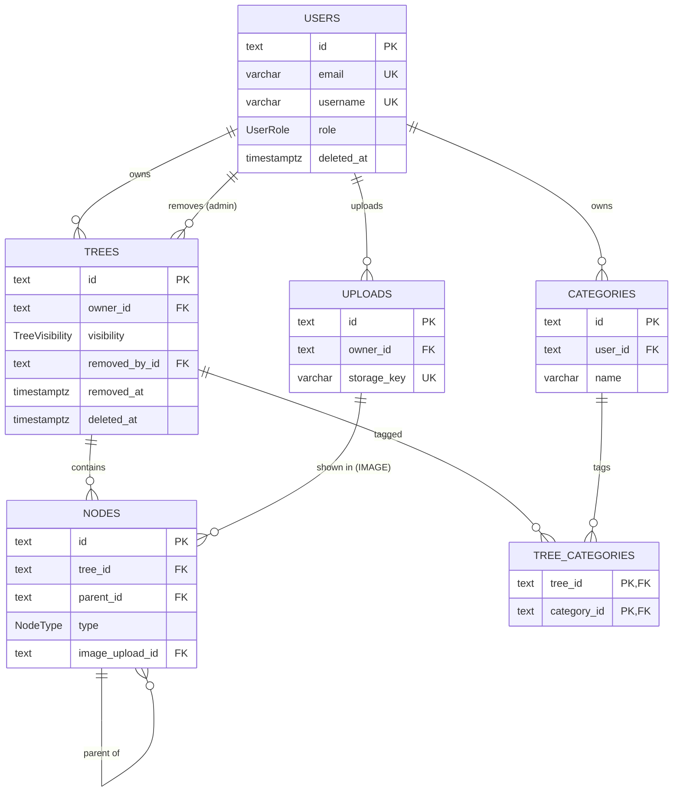

# Highdea Tree — Application Manifest

> Status: Draft (skeleton). Details marked "TBD" will be filled in later phases.
> Section headings carry the Japanese name in parentheses so the manifest-flow skills can find them.

## 1. Project Overview（プロジェクト概要）

**Highdea Tree** is a web app for visualizing ideas so people can organize their thoughts.

- A user starts with **one central idea** ("highdea") and **branches it out** into child ideas, forming a visual tree / mind map.
- Each node can hold anything: **raw text thoughts, website links, videos**, etc.
- Users can **categorize** their idea trees.
- Users can **browse other people's public highdeas** for inspiration.

**Target users:** anyone who wants to think visually — students, creators, developers, planners.
**Problem solved:** linear notes make it hard to see how ideas connect. Highdea Tree makes structure visible.

## 2. User Roles (RBAC)（ユーザーロール定義）

| Role | Description |
|---|---|
| Guest | Not logged in. Can browse public trees only. |
| User | Registered account. Creates and manages their own trees. |
| Admin | Moderates public content. Has no access to private trees. |

| Action | Guest | User | Admin |
|---|---|---|---|
| View public trees | ✅ | ✅ | ✅ |
| Sign up / log in | ✅ | — | — |
| Create / edit / delete own trees & nodes | ❌ | ✅ (own only) | ✅ |
| Manage own categories | ❌ | ✅ | ✅ |
| View others' private trees | ❌ | ❌ | ❌ |
| Remove inappropriate public content | ❌ | ❌ | ✅ |

## 3. Functional Requirements（機能要件）

### 3.1 Authentication
Sign up, log in, log out. Each user has a public profile (username, display name, avatar).

### 3.2 Idea Trees (Boards)
- Create a tree with a title and a **root (center) idea**.
- Each tree has a **visibility**: `PRIVATE` (default) or `PUBLIC`. Only `PUBLIC` trees appear in Explore.
- Edit / delete own trees.

### 3.3 Idea Nodes
- Add child nodes branching from any node (rule: every node except the root has exactly one parent).
- Node types: `TEXT` (raw thought), `LINK` (website), `VIDEO` (e.g. YouTube URL, embedded), `IMAGE` (uploaded image).
- For `LINK`, the **backend fetches a preview** (page title + thumbnail) when the URL is saved, and stores it on the node.
- `IMAGE` uploads are stored on local disk (`backend/uploads/`) in development; cloud storage (S3) later. **[TBD]** max file size and allowed formats.
- Drag nodes to reposition; node positions are saved.
- Deleting a node deletes its subtree (with confirmation).

### 3.4 Categories
- Users create their own categories (name + color) and assign them to trees.
- A tree can have **multiple categories** (tag-style).

### 3.5 Explore
- Browse a feed of public trees from all users, filter by category / search by title.
- View a public tree read-only, and view a user's profile with their public trees.

## 4. Screens & Navigation（画面遷移・構成）

| Screen | Path | Purpose |
|---|---|---|
| Landing | `/` | Intro + links to Explore / Sign up |
| Sign up / Log in | `/signup`, `/login` | Authentication |
| My Trees (Dashboard) | `/me` | List own trees, filter by category |
| Tree Editor (canvas) | `/trees/:id/edit` | Visual branching editor |
| Tree Viewer | `/trees/:id` | Read-only view (public or own) |
| Explore | `/explore` | Public trees feed |
| User Profile | `/u/:username` | A user's public trees |
| Settings | `/settings` | Profile & category management |

> Details TBD (screen design phase)

## 5. Data Modeling（データモデリング）

Common policies:
- **DB:** PostgreSQL. **ORM:** Prisma 7.10.1. The connection URL lives in `backend/prisma.config.ts`, not in `schema.prisma`.
- **Primary keys:** `cuid` strings (`String @id @default(cuid())`, stored as `TEXT`).
- **State columns:** Prisma `enum` (PostgreSQL enum types): `UserRole`, `TreeVisibility`, `NodeType`.
- **Naming:** Prisma models and fields are `camelCase` (the JSON uses the same). DB tables and columns are plural `snake_case`, mapped with `@map` / `@@map`. **[To confirm]**
- **Timestamps:** `TIMESTAMPTZ(3)`, stored in UTC. The frontend converts them to the viewer's local time. **[To confirm]**
- **Text:** `VARCHAR(n)` where a length limit is a business rule, `TEXT` for free text and URLs.

### 5.1 ER Diagram（ER図）



### 5.2 Table Definitions（テーブル定義）

#### users（ユーザー）

| Column | Type | Constraints | Description |
|---|---|---|---|
| id | TEXT | PK, DEFAULT cuid() | User ID |
| email | VARCHAR(255) | NOT NULL, UNIQUE | Login email, stored in lowercase |
| username | VARCHAR(30) | NOT NULL, UNIQUE | Public handle used in `/u/:username`. Allowed characters: `a-z 0-9 _` |
| display_name | VARCHAR(50) | NOT NULL | Name shown on the profile and on trees |
| password_hash | VARCHAR(255) | NOT NULL | bcrypt hash |
| avatar_url | TEXT | NULL | Profile image URL **[To confirm]** whether avatars use the uploads table |
| role | UserRole | NOT NULL, DEFAULT 'USER' | `USER` / `ADMIN` |
| created_at | TIMESTAMPTZ(3) | NOT NULL, DEFAULT now() | Created at |
| updated_at | TIMESTAMPTZ(3) | NOT NULL | Updated at (set by Prisma `@updatedAt`) |
| deleted_at | TIMESTAMPTZ(3) | NULL | Set when the account is deactivated |

**Business rules and constraints**
- Email and username are unique. Enforced in the **DB** (UNIQUE) and the **app layer** (AuthService lowercases the email and checks the username format before saving).
- `password_hash` is never included in an API response. Enforced in the **app layer**: services always use an explicit `select` without it.
- A deactivated user (`deleted_at` set) can't log in, and their profile and public trees are hidden. Enforced in the **app layer** (AuthService, UserService, ExploreService filter on `deleted_at IS NULL`).
- Only `ADMIN` users can call `/api/admin/*`. Enforced in the **app layer** (role-check middleware).
- Users can't change their own `role` through `PATCH /api/users/me`. Enforced in the **app layer** (the Zod schema doesn't accept `role`).

#### trees（アイデアツリー）

| Column | Type | Constraints | Description |
|---|---|---|---|
| id | TEXT | PK, DEFAULT cuid() | Tree ID |
| owner_id | TEXT | NOT NULL, FK→users.id | Owner |
| title | VARCHAR(100) | NOT NULL | Tree title |
| description | VARCHAR(500) | NULL | Short description, shown on Explore cards |
| visibility | TreeVisibility | NOT NULL, DEFAULT 'PRIVATE' | `PRIVATE` / `PUBLIC` |
| removed_at | TIMESTAMPTZ(3) | NULL | Set when an admin removes the tree |
| removed_by_id | TEXT | NULL, FK→users.id | The admin who removed it |
| removal_reason | VARCHAR(500) | NULL | Removal reason, shown to the owner |
| created_at | TIMESTAMPTZ(3) | NOT NULL, DEFAULT now() | Created at |
| updated_at | TIMESTAMPTZ(3) | NOT NULL | Updated at. Explore sorts by this |
| deleted_at | TIMESTAMPTZ(3) | NULL | Set when the owner deletes the tree |

**Business rules and constraints**
- Only the owner can edit or delete a tree, or change its nodes and categories. Enforced in the **app layer** (TreeService checks `owner_id = current user`).
- A `PRIVATE` tree can only be seen by its owner, and admins can't see it either. Enforced in the **app layer**: TreeService returns 404 (not 403) to anyone else, so the tree's existence isn't revealed.
- Explore and public profiles show only trees where `visibility = 'PUBLIC'`, `removed_at` and `deleted_at` are NULL, and the owner isn't deactivated. Enforced in the **app layer** (ExploreService and UserService).
- Admins can remove only `PUBLIC` trees. Enforced in the **app layer** (AdminService rejects removal of `PRIVATE` trees).
- A removed tree can't be made `PUBLIC` again by its owner. The owner can still view and edit it privately. Enforced in the **app layer** (TreeService). **[To confirm]**
- Creating a tree also creates its root node, in the same transaction. Enforced in the **app layer** (TreeService uses `prisma.$transaction`).
- Editing a node bumps the tree's `updated_at`. Enforced in the **app layer** (NodeService updates the tree in the same transaction).

#### nodes（アイデアノード）

| Column | Type | Constraints | Description |
|---|---|---|---|
| id | TEXT | PK, DEFAULT cuid() | Node ID |
| tree_id | TEXT | NOT NULL, FK→trees.id | The tree it belongs to |
| parent_id | TEXT | NULL, FK→nodes.id | Parent node. NULL means the root (center idea) |
| type | NodeType | NOT NULL, DEFAULT 'TEXT' | `TEXT` / `LINK` / `VIDEO` / `IMAGE` |
| title | VARCHAR(200) | NOT NULL | The idea in short. For `TEXT` nodes this is the thought itself |
| body | TEXT | NULL | Longer note, allowed on any type |
| url | TEXT | NULL | Required for `LINK` and `VIDEO` |
| preview_title | VARCHAR(300) | NULL | `LINK` only: page title fetched by the server |
| preview_description | VARCHAR(1000) | NULL | `LINK` only: page description fetched by the server |
| preview_image_url | TEXT | NULL | `LINK` only: thumbnail URL fetched by the server |
| preview_fetched_at | TIMESTAMPTZ(3) | NULL | When the preview was last fetched |
| image_upload_id | TEXT | NULL, FK→uploads.id | Required for `IMAGE` |
| position_x | DOUBLE PRECISION | NOT NULL, DEFAULT 0 | Canvas X position |
| position_y | DOUBLE PRECISION | NOT NULL, DEFAULT 0 | Canvas Y position |
| sort_order | INTEGER | NOT NULL, DEFAULT 0 | Order among siblings, used by the d3-hierarchy layout |
| created_at | TIMESTAMPTZ(3) | NOT NULL, DEFAULT now() | Created at |
| updated_at | TIMESTAMPTZ(3) | NOT NULL | Updated at |

**Business rules and constraints**
- Each tree has exactly one root node (`parent_id IS NULL`). Enforced in the **app layer**: TreeService creates it with the tree, and NodeService rejects creating another root or deleting the root. Optional extra: a partial unique index added by raw SQL in the migration, `CREATE UNIQUE INDEX nodes_one_root_per_tree ON nodes(tree_id) WHERE parent_id IS NULL;` (Prisma can't express partial indexes). **[To confirm]**
- A node's parent must belong to the same tree. Enforced in the **app layer** (NodeService).
- A node can't be moved under itself or under one of its own descendants. Enforced in the **app layer** (NodeService walks up the ancestors when `parentId` changes). **[To confirm]** whether re-parenting is allowed at all.
- Required fields depend on the type. Enforced in the **app layer** (a Zod discriminated union on `type`):
  - `TEXT`: `title` only.
  - `LINK`: `url` (http/https).
  - `VIDEO`: `url` from an allowed provider (YouTube or Vimeo **[To confirm]**).
  - `IMAGE`: `image_upload_id`, pointing to an upload owned by the same user.
- Preview fields are set only by the server after it fetches the link (`POST /api/link-preview` or when a `LINK` node is saved). Clients can't write them directly. Enforced in the **app layer**.
- Deleting a node deletes its whole subtree. Enforced in the **DB** (self-FK `ON DELETE CASCADE`); the UI asks for confirmation first.
- **[To confirm]** a maximum number of nodes per tree (e.g. 500).

#### categories（カテゴリ）

| Column | Type | Constraints | Description |
|---|---|---|---|
| id | TEXT | PK, DEFAULT cuid() | Category ID |
| user_id | TEXT | NOT NULL, FK→users.id | Owner |
| name | VARCHAR(50) | NOT NULL | Category name |
| color | VARCHAR(7) | NOT NULL, DEFAULT '#6B7280' | Hex color, e.g. `#FF8800` |
| created_at | TIMESTAMPTZ(3) | NOT NULL, DEFAULT now() | Created at |
| updated_at | TIMESTAMPTZ(3) | NOT NULL | Updated at |

**Business rules and constraints**
- Category names are unique per user. Enforced in the **DB** (UNIQUE(user_id, name)).
- `color` must be a `#RRGGBB` hex value. Enforced in the **app layer** (Zod regex).
- Only the owner can edit or delete a category. Enforced in the **app layer** (CategoryService).
- **[To confirm]** Categories belong to each user, but Explore filters by `?category=`. Plan: Explore matches on the category **name**, case-insensitive, across all users (indexed on `name`). The alternative is a shared, global category list.

#### tree_categories（ツリー×カテゴリ 中間テーブル）

| Column | Type | Constraints | Description |
|---|---|---|---|
| tree_id | TEXT | PK, FK→trees.id | Tree |
| category_id | TEXT | PK, FK→categories.id | Category |
| created_at | TIMESTAMPTZ(3) | NOT NULL, DEFAULT now() | When the tag was added |

**Business rules and constraints**
- A tree can have the same category only once. Enforced in the **DB** (composite PK).
- A tree can only use categories owned by the tree's owner. Enforced in the **app layer** (TreeService checks this when setting categories).
- **[To confirm]** a maximum number of categories per tree (e.g. 10).

#### uploads（アップロード画像）

| Column | Type | Constraints | Description |
|---|---|---|---|
| id | TEXT | PK, DEFAULT cuid() | Upload ID |
| owner_id | TEXT | NOT NULL, FK→users.id | Uploader |
| storage_key | VARCHAR(255) | NOT NULL, UNIQUE | Relative path in `backend/uploads/` (an S3 key later) |
| original_name | VARCHAR(255) | NOT NULL | Original file name |
| mime_type | VARCHAR(100) | NOT NULL | e.g. `image/png` |
| size_bytes | INTEGER | NOT NULL | File size |
| created_at | TIMESTAMPTZ(3) | NOT NULL, DEFAULT now() | Uploaded at |

**Business rules and constraints**
- Only image MIME types are accepted, up to a size limit. Enforced in the **app layer** (Multer file filter and limits). **[To confirm]** formats (e.g. png, jpeg, webp, gif) and maximum size (e.g. 5 MB).
- The server generates `storage_key` (a cuid plus the file extension). The client's file name is never used as a path. Enforced in the **app layer** (UploadService).
- An upload can't be deleted while a node still uses it. Enforced in the **DB** (FK `ON DELETE RESTRICT`).
- Uploads no longer used by any node are deleted later by a cleanup job. Enforced in the **app layer** (a scheduled job). **[To confirm]**

### 5.3 Deletion Policy（削除・無効化ポリシー）

| Resource | Policy | Implementation | Related data | Notes |
|---|---|---|---|---|
| User | Deactivate (soft delete) | `users.deleted_at` | Trees, categories and uploads are kept but hidden from everyone | No account-deletion screen yet. **[To confirm]** |
| Tree (owner deletes) | Soft delete | `trees.deleted_at` | Nodes and tags kept, so the tree can be restored or purged later | **[To confirm]** a restore feature and a purge period (e.g. 30 days) |
| Tree (admin removes) | Hide from public | `trees.removed_at`, `removed_by_id`, `removal_reason` | Owner keeps private access | Kept separate from `deleted_at`, so moderation actions stay auditable |
| Node | Hard delete | `DELETE` | Whole subtree deleted (DB CASCADE). The image file stays until cleanup | Nodes have no history, so a soft delete isn't needed |
| Category | Hard delete | `DELETE` | Its `tree_categories` rows are deleted (CASCADE). Trees stay | |
| Tree–category tag | Hard delete | `DELETE` | — | Changing a tree's categories replaces all its tag rows |
| Upload | Hard delete (by cleanup job) | `DELETE` + remove the file | Blocked while any node uses it (RESTRICT) | |

FK `ON DELETE` rules:
- Links to `users`: `RESTRICT`. Users are only soft-deleted, so a physical delete would mean a mistake.
- `nodes.tree_id`, `nodes.parent_id`, `tree_categories.*`: `CASCADE`. These are owned children.
- `nodes.image_upload_id`: `RESTRICT`.

### 5.4 Prisma Schema（schema.prisma）

```prisma
generator client {
  provider = "prisma-client-js"
}

// Prisma 7: the connection URL (DATABASE_URL) is set in backend/prisma.config.ts, not here.
datasource db {
  provider = "postgresql"
}

enum UserRole {
  USER
  ADMIN
}

enum TreeVisibility {
  PRIVATE
  PUBLIC
}

enum NodeType {
  TEXT
  LINK
  VIDEO
  IMAGE
}

model User {
  id           String    @id @default(cuid())
  email        String    @unique @db.VarChar(255)
  username     String    @unique @db.VarChar(30)
  displayName  String    @map("display_name") @db.VarChar(50)
  passwordHash String    @map("password_hash") @db.VarChar(255)
  avatarUrl    String?   @map("avatar_url")
  role         UserRole  @default(USER)
  createdAt    DateTime  @default(now()) @map("created_at") @db.Timestamptz(3)
  updatedAt    DateTime  @updatedAt @map("updated_at") @db.Timestamptz(3)
  deletedAt    DateTime? @map("deleted_at") @db.Timestamptz(3)

  trees        Tree[]     @relation("TreeOwner")
  removedTrees Tree[]     @relation("TreeRemovedBy")
  categories   Category[]
  uploads      Upload[]

  @@map("users")
}

model Tree {
  id            String         @id @default(cuid())
  ownerId       String         @map("owner_id")
  title         String         @db.VarChar(100)
  description   String?        @db.VarChar(500)
  visibility    TreeVisibility @default(PRIVATE)
  removedAt     DateTime?      @map("removed_at") @db.Timestamptz(3)
  removedById   String?        @map("removed_by_id")
  removalReason String?        @map("removal_reason") @db.VarChar(500)
  createdAt     DateTime       @default(now()) @map("created_at") @db.Timestamptz(3)
  updatedAt     DateTime       @updatedAt @map("updated_at") @db.Timestamptz(3)
  deletedAt     DateTime?      @map("deleted_at") @db.Timestamptz(3)

  owner      User           @relation("TreeOwner", fields: [ownerId], references: [id], onDelete: Restrict)
  removedBy  User?          @relation("TreeRemovedBy", fields: [removedById], references: [id], onDelete: Restrict)
  nodes      Node[]
  categories TreeCategory[]

  @@index([ownerId, deletedAt, updatedAt(sort: Desc)])
  @@index([visibility, removedAt, deletedAt, updatedAt(sort: Desc)])
  @@map("trees")
}

model Node {
  id                 String    @id @default(cuid())
  treeId             String    @map("tree_id")
  parentId           String?   @map("parent_id")
  type               NodeType  @default(TEXT)
  title              String    @db.VarChar(200)
  body               String?
  url                String?
  previewTitle       String?   @map("preview_title") @db.VarChar(300)
  previewDescription String?   @map("preview_description") @db.VarChar(1000)
  previewImageUrl    String?   @map("preview_image_url")
  previewFetchedAt   DateTime? @map("preview_fetched_at") @db.Timestamptz(3)
  imageUploadId      String?   @map("image_upload_id")
  positionX          Float     @default(0) @map("position_x")
  positionY          Float     @default(0) @map("position_y")
  sortOrder          Int       @default(0) @map("sort_order")
  createdAt          DateTime  @default(now()) @map("created_at") @db.Timestamptz(3)
  updatedAt          DateTime  @updatedAt @map("updated_at") @db.Timestamptz(3)

  tree        Tree    @relation(fields: [treeId], references: [id], onDelete: Cascade)
  parent      Node?   @relation("NodeChildren", fields: [parentId], references: [id], onDelete: Cascade)
  children    Node[]  @relation("NodeChildren")
  imageUpload Upload? @relation(fields: [imageUploadId], references: [id], onDelete: Restrict)

  @@index([treeId])
  @@index([parentId, sortOrder])
  @@index([imageUploadId])
  @@map("nodes")
}

model Category {
  id        String   @id @default(cuid())
  userId    String   @map("user_id")
  name      String   @db.VarChar(50)
  color     String   @default("#6B7280") @db.VarChar(7)
  createdAt DateTime @default(now()) @map("created_at") @db.Timestamptz(3)
  updatedAt DateTime @updatedAt @map("updated_at") @db.Timestamptz(3)

  user  User           @relation(fields: [userId], references: [id], onDelete: Restrict)
  trees TreeCategory[]

  @@unique([userId, name])
  @@index([name])
  @@map("categories")
}

model TreeCategory {
  treeId     String   @map("tree_id")
  categoryId String   @map("category_id")
  createdAt  DateTime @default(now()) @map("created_at") @db.Timestamptz(3)

  tree     Tree     @relation(fields: [treeId], references: [id], onDelete: Cascade)
  category Category @relation(fields: [categoryId], references: [id], onDelete: Cascade)

  @@id([treeId, categoryId])
  @@index([categoryId])
  @@map("tree_categories")
}

model Upload {
  id           String   @id @default(cuid())
  ownerId      String   @map("owner_id")
  storageKey   String   @unique @map("storage_key") @db.VarChar(255)
  originalName String   @map("original_name") @db.VarChar(255)
  mimeType     String   @map("mime_type") @db.VarChar(100)
  sizeBytes    Int      @map("size_bytes")
  createdAt    DateTime @default(now()) @map("created_at") @db.Timestamptz(3)

  owner User   @relation(fields: [ownerId], references: [id], onDelete: Restrict)
  nodes Node[]

  @@index([ownerId])
  @@map("uploads")
}
```

## 6. API Design（API設計）

Policies:
- REST, JSON, base path `/api`.
- Auth: JWT stored in an **httpOnly cookie** (`Secure`, `SameSite`), set on login and cleared on logout.
- Common response shape: `{ "data": ... }` on success, `{ "error": { "code", "message" } }` on failure.
- Request validation with Zod; shared types between frontend and backend.

| Resource | Main endpoints |
|---|---|
| Auth | `POST /api/auth/signup`, `POST /api/auth/login`, `POST /api/auth/logout`, `GET /api/auth/me` |
| Users | `GET /api/users/:username`, `PATCH /api/users/me` |
| Trees | `GET /api/trees` (mine), `POST /api/trees`, `GET /api/trees/:id`, `PATCH /api/trees/:id`, `DELETE /api/trees/:id` |
| Nodes | `POST /api/trees/:id/nodes`, `PATCH /api/nodes/:id`, `DELETE /api/nodes/:id` |
| Categories | `GET /api/categories`, `POST /api/categories`, `PATCH /api/categories/:id`, `DELETE /api/categories/:id` |
| Explore | `GET /api/explore` (public trees, paginated, `?category=&q=`) |
| Uploads | `POST /api/uploads` (image upload, multipart) |
| Link preview | `POST /api/link-preview` (fetch title/thumbnail for a URL) |
| Admin | `DELETE /api/admin/trees/:id` (remove a public tree) |

> Request/response details TBD (API design phase)

## 7. Tech Stack（技術スタック）

| Layer | Technology |
|---|---|
| Language | TypeScript (frontend & backend) |
| Frontend | React + Vite, React Router |
| Canvas / tree visualization | Custom SVG + D3 (`d3-hierarchy` for layout, `d3-zoom` for pan/zoom) |
| Frontend data fetching | TanStack Query |
| Styling | Tailwind CSS |
| Backend | Node.js + Express |
| Validation | Zod |
| ORM | Prisma 7.10.1 (DB URL in `prisma.config.ts`) |
| Database | PostgreSQL |
| Auth | JWT (httpOnly cookie) + bcrypt |
| File uploads | Multer → local disk (`backend/uploads/`) in dev; S3 later |
| Dev environment | Docker Compose (PostgreSQL) |
| Testing | Vitest (unit), Playwright (E2E) |

> Exact versions TBD.

## 8. Directory Structure（ディレクトリ構成）

Monorepo:

```
highdea_tree_app/
├── CLAUDE.md
├── MANIFEST.md
├── docker-compose.yml
├── frontend/
│   ├── src/
│   │   ├── pages/
│   │   ├── components/
│   │   ├── features/      # tree-editor, explore, auth, ...
│   │   ├── api/
│   │   └── types/
│   └── package.json
└── backend/
    ├── src/
    │   ├── routes/
    │   ├── controllers/
    │   ├── services/
    │   ├── middleware/
    │   └── lib/
    ├── prisma/
    │   └── schema.prisma
    ├── prisma.config.ts   # Prisma 7 config (DATABASE_URL)
    ├── uploads/           # dev image storage (gitignored)
    └── package.json
```

## 9. Development Setup（開発環境構築）

1. Requirements: Node.js (LTS), npm, Docker.
2. `docker compose up -d` — start PostgreSQL.
3. `backend/`: copy `.env.example` → `.env`, `npm install`, `npx prisma migrate dev`, `npm run dev`.
4. `frontend/`: `npm install`, `npm run dev`.

> Details TBD (Phase 1 setup).

## 10. Future Extensions (Out of Scope)（将来の拡張）

Candidates — confirm or remove:
- Likes / bookmarks / "fork" someone else's tree
- Comments on public trees
- Real-time collaborative editing
- Cloud storage (S3) for uploaded images
- `UNLISTED` (link-only) tree visibility
- Cross-links between nodes (graph, not just tree)
- AI suggestions for branching ideas
- Export tree as image / PDF
