# Trees — Idea Trees, Trash and Categories

Shared types, error codes and authorization rules are defined in [common.md](./common.md). Start from [index.md](./index.md).

## 1. Overview

Creating, listing, viewing, editing and deleting trees; the Trash and restore; categories and tagging; the tree lifecycle. Related: [nodes.md](./nodes.md) (a tree's nodes and the editor canvas), [explore.md](./explore.md) (public trees, admin removal), [users.md](./users.md) (Settings page P-10 hosts the Categories tab).

## 2. Functional Requirements

### 3.3 Idea Trees

- Create a tree with a title and a **root (center) idea**; the tree and its root are created together.
- Each tree has a **visibility**: `PRIVATE` (default) or `PUBLIC`. Only public trees appear in Explore and on profiles.
- Edit title, description, visibility and categories (up to **10 categories** per tree, only the user's own).
- Owners see all their trees on My Trees, filterable by category. Admins don't see other users' trees there.
- A tree removed by an admin stays with its owner, privately, with the admin's reason shown; it can't be made public again (§3.9).
- **Pages/modals:** P-04, P-05, P-06, M-01, M-02. **API:** `GET /api/trees`, `POST /api/trees`, `GET /api/trees/:id`, `PATCH /api/trees/:id`. **Tables:** `trees`, `nodes` (root), `tree_categories`.

### 3.4 Trash

- Deleting a tree moves it to the owner's **Trash**, with its nodes and categories intact. From there it can be restored.
- Trees in the Trash are **permanently deleted 10 days** after they were deleted, with their nodes and category tags. The Trash shows the days left.
- A restored tree keeps the visibility it had; a removed tree stays removed.
- Trees in the Trash can't be viewed or edited.
- The owner can also **delete a tree permanently right away** ("Delete forever" on one tree, or "Empty Trash" for all of them), after a confirmation. This can't be undone; it removes the same data as the purge job.
- **Pages/modals:** P-09, M-03, M-13. **API:** `DELETE /api/trees/:id`, `GET /api/trash`, `POST /api/trees/:id/restore`, `DELETE /api/trash/:id`, `DELETE /api/trash`. **Tables:** `trees.deleted_at`; purge job (§3.10).

### 3.7 Categories

- Users create their own categories (name + color) and assign them to trees; a tree can have **multiple categories** (up to 10).
- Category names are unique per user, ignoring upper/lower case. A user can have at most **100 categories**.
- Renaming or recoloring a category updates every tree that uses it. Deleting a category removes it from its trees (including trees in the Trash) but keeps the trees.
- **Pages/modals:** P-10 (Categories tab), M-07, M-08, category picker in M-01 / M-02, filter on P-04. **API:** `GET /api/categories`, `POST /api/categories`, `PATCH /api/categories/:id`, `DELETE /api/categories/:id`. **Tables:** `categories`, `tree_categories`.

## 3. Authorization

Shared rules (owner, `404` instead of `403`, what "public tree" means): see [common.md — Authorization Rules](./common.md#authorization-rules). Endpoint-specific conditions are in each cell.

| Endpoint | Guest | `USER` | `ADMIN` |
|---|---|---|---|
| `GET /api/trees` | ❌ | ✅ own trees only | ✅ own trees only |
| `POST /api/trees` | ❌ | ✅ | ✅ |
| `GET /api/trees/:id` | ✅ public trees | ✅ public trees; own trees (incl. private, removed) | ✅ public trees; own trees |
| `PATCH /api/trees/:id` | ❌ | ✅ Owner (can't set `PUBLIC` on a removed tree) | ✅ Owner |
| `DELETE /api/trees/:id` | ❌ | ✅ Owner | ✅ Owner |
| `GET /api/trash` | ❌ | ✅ own Trash | ✅ own Trash |
| `POST /api/trees/:id/restore` | ❌ | ✅ Owner | ✅ Owner |
| `DELETE /api/trash/:id` | ❌ | ✅ Owner | ✅ Owner |
| `DELETE /api/trash` | ❌ | ✅ own Trash | ✅ own Trash |
| `GET /api/categories` | ❌ | ✅ own categories | ✅ own categories |
| `POST /api/categories` | ❌ | ✅ | ✅ |
| `PATCH /api/categories/:id` | ❌ | ✅ Owner | ✅ Owner |
| `DELETE /api/categories/:id` | ❌ | ✅ Owner | ✅ Owner |

## 4. Screens

### Pages

| ID | Screen | URL | Summary | Access |
|---|---|---|---|---|
| P-04 | My Trees (Dashboard) | `/me` | Grid of own trees (private and public): title, description, category chips, visibility badge, node count, last updated. Category filter, paging, "+ New tree". Removed trees show a "Removed by admin" badge | `USER`, `ADMIN` |
| P-09 | Trash | `/trash` | Own deleted trees with "X days left" before permanent deletion, and Restore and "Delete forever" (opens M-13) buttons on each. An "Empty Trash" button (opens M-13) above the list when the Trash isn't empty | `USER`, `ADMIN` |

### Modals

| ID | Modal | Trigger | Main functions |
|---|---|---|---|
| M-01 | New Tree | "+ New tree" button on My Trees (P-04) | Title, description, center idea text (defaults to title), visibility, category picker (up to 10, with "+ New category" opening M-07). Creates the tree and opens the Editor (`POST /api/trees`) |
| M-02 | Tree Settings | Gear button in the Editor toolbar (P-05); "Edit details" in a tree card's menu on My Trees (P-04) | Edit title, description, visibility and categories (`PATCH /api/trees/:id`). For a removed tree, shows the admin's reason and the visibility switch is disabled with "Removed by an admin; can't be made public". Has the "Move to Trash" button (opens M-03) |
| M-03 | Move Tree to Trash | "Move to Trash" in M-02; "Delete" in a tree card's menu on My Trees (P-04) | Confirm: "This tree will be in Trash for 10 days, then deleted permanently." (`DELETE /api/trees/:id`). From the Editor, then goes to `/me` |
| M-13 | Delete Permanently | "Delete forever" on a Trash item; "Empty Trash" on the Trash page (P-09) | Confirm, red button. One tree: "“{title}” will be deleted permanently, with all of its ideas. This can't be undone." (`DELETE /api/trash/:id`). Empty Trash: "All N trees in the Trash will be deleted permanently. This can't be undone." (`DELETE /api/trash`) |
| M-07 | Category Form | "+ New category" or "Edit" on the Settings Categories tab (P-10); "+ New category" inside the category picker of M-01 / M-02 | Name and color picker (`POST /api/categories`, `PATCH /api/categories/:id`). Duplicate names (ignoring upper/lower case) show the error under the name field |
| M-08 | Delete Category | "Delete" on a category row in Settings (P-10) | Confirm: "Remove this category from N trees? The trees themselves stay." (`DELETE /api/categories/:id`) |

#### Tree Lifecycle（ツリーのライフサイクル）

```mermaid
stateDiagram-v2
  [*] --> Private : Owner creates tree (POST /api/trees, visibility PRIVATE — default)
  [*] --> Public : Owner creates tree (visibility PUBLIC)

  Private --> Public : Owner sets PUBLIC (PATCH /api/trees/:id)
  Public --> Private : Owner sets PRIVATE (PATCH /api/trees/:id)

  Public --> Removed : ADMIN removes with reason (POST /api/admin/trees/:id/remove)\nvisibility set to PRIVATE, hidden from public
  Removed --> Removed : Owner edits privately; setting PUBLIC is refused (409 TREE_REMOVED)

  Private --> InTrash : Owner moves to Trash (DELETE /api/trees/:id)
  Public --> InTrash : Owner moves to Trash
  Removed --> InTrash : Owner moves to Trash

  InTrash --> Private : Owner restores (POST /api/trees/:id/restore), was Private
  InTrash --> Public : Owner restores, was Public
  InTrash --> Removed : Owner restores, was Removed (stays private)

  InTrash --> Purged : System daily job, 10 days after deletion\n(nodes and category tags deleted; unused images cleaned up)
  InTrash --> Purged : Owner deletes forever (DELETE /api/trash/:id)\nor empties the Trash (DELETE /api/trash)
  Purged --> [*]
```

| State | Who can see it | Shown where |
|---|---|---|
| Private | Owner only | My Trees, Editor, Viewer (owner) |
| Public | Everyone | My Trees, Explore, User Profile, Viewer |
| Removed | Owner only, with the admin's reason | My Trees (badge), Editor and M-02 (reason banner) |
| InTrash | Owner only | Trash (days left, Restore, Delete forever) |
| Purged | Nobody (gone) | — |

## 5. API

#### Trees

---
##### **GET /api/trees**

- **Summary（機能概要）:** Lists the logged-in user's own trees, both private and public. Used by the My Trees (Dashboard) screen.
- **Authorization（認可）:** Logged-in users (`USER`, `ADMIN`). Returns only trees the user owns; admins don't see other users' trees here.

**Request（リクエスト）**

- **Query Parameters**

| Name | Type | Required | Description |
|---|---|---|---|
| `categoryId` | `String` | | Only trees tagged with this category. Must be one of the user's own categories |
| `page` | `Int` | | Page number, starting at 1. Default `1` |
| `limit` | `Int` | | Trees per page, 1–50. Default `20` |

**Response（レスポンス）**

- **Success: `200 OK`**
  Follows the common format `{ "data": {...} }`.
  - `data.trees`: the user's trees where `deletedAt` isn't set, newest `updatedAt` first. Each item has `id`, `title`, `description`, `visibility`, `categories` (`id`, `name`, `color`), `nodeCount`, `removedAt`, `removalReason`, `createdAt` and `updatedAt`. Trees removed by an admin are still listed, with `removedAt` and `removalReason` set, so the owner can see why they were taken down.
  - `data.pagination`: `page`, `limit`, `total` (shared [Pagination](./common.md#pagination) shape).
- **Error Responses**
  Follows the common format `{ "error": { "code", "message" } }`.
  - `400` `VALIDATION_ERROR` — `page` or `limit` isn't a positive integer, or `limit` is over 50.
  - `401` `UNAUTHENTICATED` — No valid auth cookie, or the user is deactivated (`deletedAt` set).
  - `404` `CATEGORY_NOT_FOUND` — `categoryId` doesn't exist or belongs to another user.
  - `500` `INTERNAL_ERROR` — Unexpected server error.
---

---
##### **POST /api/trees**

- **Summary（機能概要）:** Creates a new tree owned by the logged-in user, together with its root node (the center idea). The tree and root node are created in one transaction, so a tree never exists without its root.
- **Authorization（認可）:** Logged-in users (`USER`, `ADMIN`). The owner is always the logged-in user, never taken from the request.

**Request（リクエスト）**

- **Body**

| Name | Type | Required | Description |
|---|---|---|---|
| `title` | `String` | ✅ | Tree title. Trimmed. 1–100 characters |
| `description` | `String \| null` | | Short description shown on cards. Trimmed. Up to 500 characters |
| `visibility` | `"PRIVATE" \| "PUBLIC"` | | Default `"PRIVATE"` |
| `categoryIds` | `String[]` | | IDs of the user's own categories to tag the tree with. Duplicates are ignored. Up to 10 |
| `rootTitle` | `String` | | Text of the center idea. Trimmed. 1–200 characters. Defaults to `title` when omitted |

**Response（レスポンス）**

- **Success: `201 Created`**
  Follows the common format `{ "data": {...} }`.
  - `data.tree`: `id`, `title`, `description`, `visibility`, `categories` (`id`, `name`, `color`), `removedAt` (`null`), `removalReason` (`null`), `createdAt`, `updatedAt`.
  - `data.rootNode`: the new root node, a `TEXT` node with `parentId` `null` at position (0, 0): `id`, `treeId`, `parentId`, `type`, `title`, `body`, `positionX`, `positionY`, `sortOrder`, `lineColor` (`null`), `cardColor` (`null`), `createdAt`, `updatedAt`.
  The frontend then opens the Tree Editor (`/trees/:id/edit`).
- **Error Responses**
  Follows the common format `{ "error": { "code", "message" } }`.
  - `400` `VALIDATION_ERROR` — `title` is missing, or a field breaks the rules above (lengths, visibility value, more than 10 categories, field not allowed).
  - `401` `UNAUTHENTICATED` — No valid auth cookie, or the user is deactivated (`deletedAt` set).
  - `404` `CATEGORY_NOT_FOUND` — One of `categoryIds` doesn't exist or belongs to another user. Nothing is created.
  - `500` `INTERNAL_ERROR` — Unexpected server error. The transaction is rolled back, so no half-created tree is left.
---

---
##### **GET /api/trees/:id**

- **Summary（機能概要）:** Returns one tree with all of its nodes. Used by the Tree Editor (`/trees/:id/edit`) and the Tree Viewer (`/trees/:id`).
- **Authorization（認可）:** Anyone, with these conditions. Login is optional; an invalid or expired cookie is treated as a guest.
  - **Owner:** can see their own tree whether `PRIVATE` or `PUBLIC`, including after an admin removed it.
  - **Everyone else (Guest, `USER`, `ADMIN`):** only when the tree is `PUBLIC`, not removed (`removedAt` not set), and the owner isn't deactivated. Admins get no extra access to private trees.
  - A tree that is deleted (`deletedAt` set) can't be seen by anyone, including the owner.
  - Any tree the caller isn't allowed to see returns `404`, not `403`, so the response doesn't reveal that a private tree exists.

**Request（リクエスト）**

- **Path Parameters**

| Name | Type | Description |
|---|---|---|
| `id` | `String` | Tree ID (cuid) |

**Response（レスポンス）**

- **Success: `200 OK`**
  Follows the common format `{ "data": {...} }`.
  - `data.tree`: `id`, `title`, `description`, `visibility`, `categories` (`id`, `name`, `color`), `removedAt`, `removalReason`, `createdAt`, `updatedAt`. `removedAt` and `removalReason` are only filled in for the owner; for anyone else they're always `null`.
  - `data.owner`: `username`, `displayName`, `avatarUrl`.
  - `data.isOwner`: `true` when the logged-in user owns the tree. The frontend uses it to decide between the editor and the read-only viewer.
  - `data.nodes`: the **skeleton** of every node in the tree (up to 2,000), as a flat list (not nested). The frontend builds the hierarchy from `parentId` with `d3-hierarchy`. Each node has only the light fields: `id`, `parentId`, `type`, `title`, `positionX`, `positionY`, `sortOrder`, `lineColor`, `cardColor`, `updatedAt`. Exactly one node has `parentId` `null`: the root. Heavy content (`body`, `url`, link preview, `imageUrl`) isn't included; the canvas lazy-loads it with `GET /api/trees/:id/nodes?ids=` as nodes come into view. `updatedAt` tells the frontend when its cached details for a node are stale.
  - `data.connections`: every connection between two ideas of the tree (up to 500), each `{ id, nodeAId, nodeBId }`, oldest first. The canvas draws them as dotted lines besides the parent → child lines ([nodes.md](./nodes.md) §3.5, Connections).
- **Error Responses**
  Follows the common format `{ "error": { "code", "message" } }`.
  - `404` `TREE_NOT_FOUND` — The tree doesn't exist, is deleted, or the caller isn't allowed to see it (see Authorization).
  - `500` `INTERNAL_ERROR` — Unexpected server error.
---

---
##### **PATCH /api/trees/:id**

- **Summary（機能概要）:** Updates a tree's settings: title, description, visibility and categories. Nodes are edited through the Nodes endpoints, not here.
- **Authorization（認可）:** The tree's owner only (`USER` or `ADMIN` who owns it). Admins can't edit other users' trees. Anyone else gets `404`, so the response doesn't reveal that a private tree exists.

**Request（リクエスト）**

- **Path Parameters**

| Name | Type | Description |
|---|---|---|
| `id` | `String` | Tree ID (cuid) |

- **Body**
  Send only the fields to change; at least one is required. Any other field (e.g. `ownerId`, `removedAt`) is rejected.

| Name | Type | Required | Description |
|---|---|---|---|
| `title` | `String` | | Trimmed. 1–100 characters |
| `description` | `String \| null` | | Trimmed. Up to 500 characters. `null` clears it |
| `visibility` | `"PRIVATE" \| "PUBLIC"` | | Making a removed tree `PUBLIC` is rejected (see `409`) |
| `categoryIds` | `String[]` | | Replaces all of the tree's categories. Only the user's own categories, up to 10. Duplicates are ignored. `[]` removes all categories |

**Response（レスポンス）**

- **Success: `200 OK`**
  Follows the common format `{ "data": {...} }`. `data.tree` is the updated tree: `id`, `title`, `description`, `visibility`, `categories` (`id`, `name`, `color`), `removedAt`, `removalReason`, `createdAt`, `updatedAt`. Changing categories and the other fields happens in one transaction.
- **Error Responses**
  Follows the common format `{ "error": { "code", "message" } }`.
  - `400` `VALIDATION_ERROR` — The body is empty, has a field that isn't allowed, or breaks a rule above (lengths, visibility value, more than 10 categories).
  - `401` `UNAUTHENTICATED` — No valid auth cookie, or the user is deactivated (`deletedAt` set).
  - `404` `TREE_NOT_FOUND` — The tree doesn't exist, is deleted, or isn't owned by the caller.
  - `404` `CATEGORY_NOT_FOUND` — One of `categoryIds` doesn't exist or belongs to another user. Nothing is changed.
  - `409` `TREE_REMOVED` — The request sets `visibility` to `PUBLIC` but an admin removed this tree (removal already set it to `PRIVATE`). The owner can still edit it and keep it private.
  - `500` `INTERNAL_ERROR` — Unexpected server error.
---

---
##### **DELETE /api/trees/:id**

- **Summary（機能概要）:** Deletes a tree. It's a soft delete: `deletedAt` is set, and the tree and its nodes stay in the database but disappear from every screen and API. The frontend asks for confirmation first.
- **Authorization（認可）:** The tree's owner only (`USER` or `ADMIN` who owns it). Admins remove public trees with `POST /api/admin/trees/:id/remove` instead. Anyone else gets `404`, so the response doesn't reveal that a private tree exists.

**Request（リクエスト）**

- **Path Parameters**

| Name | Type | Description |
|---|---|---|
| `id` | `String` | Tree ID (cuid) |

**Response（レスポンス）**

- **Success: `200 OK`**
  Follows the common format: `{ "data": null }`.
  The owner can delete a tree that an admin removed; its removal fields are kept, so the moderation record stays. Nodes, category tags and uploaded images aren't touched. The tree moves to the owner's Trash, where it can be restored with `POST /api/trees/:id/restore`. 10 days after deletion, a daily job deletes it permanently with its nodes and category tags.
- **Error Responses**
  Follows the common format `{ "error": { "code", "message" } }`.
  - `401` `UNAUTHENTICATED` — No valid auth cookie, or the user is deactivated (`deletedAt` set).
  - `404` `TREE_NOT_FOUND` — The tree doesn't exist, is already deleted, or isn't owned by the caller.
  - `500` `INTERNAL_ERROR` — Unexpected server error.
---

#### Trash

---
##### **GET /api/trash**

- **Summary（機能概要）:** Lists the logged-in user's deleted trees (the Trash), with how long each has left before it's permanently deleted. Used by the Trash screen (`/trash`).
- **Authorization（認可）:** Logged-in users (`USER`, `ADMIN`). Returns only the user's own deleted trees; admins don't see other users' Trash.

**Request（リクエスト）**

- **Query Parameters**

| Name | Type | Required | Description |
|---|---|---|---|
| `page` | `Int` | | Page number, starting at 1. Default `1` |
| `limit` | `Int` | | Trees per page, 1–50. Default `20` |

**Response（レスポンス）**

- **Success: `200 OK`**
  Follows the common format `{ "data": {...} }`.
  - `data.trees`: the user's trees where `deletedAt` is set and not yet purged, most recently deleted first. Each item has `id`, `title`, `description`, `visibility`, `categories` (`id`, `name`, `color`), `nodeCount`, `removedAt`, `deletedAt` and `purgeAt`. `purgeAt` is `deletedAt` + 10 days: when the daily job will delete it permanently. The screen shows it as "days left".
  - `data.pagination`: `page`, `limit`, `total` (shared [Pagination](./common.md#pagination) shape).
- **Error Responses**
  Follows the common format `{ "error": { "code", "message" } }`.
  - `400` `VALIDATION_ERROR` — `page` or `limit` isn't a positive integer, or `limit` is over 50.
  - `401` `UNAUTHENTICATED` — No valid auth cookie, or the user is deactivated (`deletedAt` set).
  - `500` `INTERNAL_ERROR` — Unexpected server error.
---

---
##### **POST /api/trees/:id/restore**

- **Summary（機能概要）:** Restores a tree from the Trash by clearing its `deletedAt`. The tree comes back with all of its nodes and category tags, and appears in My Trees again.
- **Authorization（認可）:** The tree's owner only (`USER` or `ADMIN` who owns it). Anyone else gets `404`.

**Request（リクエスト）**

- **Path Parameters**

| Name | Type | Description |
|---|---|---|
| `id` | `String` | Tree ID (cuid) |

No body.

**Response（レスポンス）**

- **Success: `200 OK`**
  Follows the common format `{ "data": {...} }`. `data.tree` is the restored tree, with the same fields as `GET /api/trees`: `id`, `title`, `description`, `visibility`, `categories` (`id`, `name`, `color`), `nodeCount`, `removedAt`, `removalReason`, `createdAt`, `updatedAt`.
  The tree keeps the visibility it had when it was deleted, so a public tree is public again right away. A tree an admin removed stays removed and private (admin removal sets `visibility` to `PRIVATE`).
- **Error Responses**
  Follows the common format `{ "error": { "code", "message" } }`.
  - `401` `UNAUTHENTICATED` — No valid auth cookie, or the user is deactivated (`deletedAt` set).
  - `404` `TREE_NOT_FOUND` — The tree doesn't exist, was already permanently deleted (more than 10 days in the Trash), or isn't owned by the caller.
  - `409` `TREE_NOT_IN_TRASH` — The tree isn't in the Trash (`deletedAt` isn't set), so there's nothing to restore.
  - `500` `INTERNAL_ERROR` — Unexpected server error.
---

---
##### **DELETE /api/trash/:id**

- **Summary（機能概要）:** Permanently deletes one tree from the Trash, right away instead of waiting for the 10-day purge. Its nodes and category tags are deleted with it (`ON DELETE CASCADE`); its uploaded images become unused and are removed by the uploads cleanup job. Can't be undone, so the frontend asks for confirmation first (M-13).
- **Authorization（認可）:** The tree's owner only (`USER` or `ADMIN` who owns it). Anyone else gets `404`.

**Request（リクエスト）**

- **Path Parameters**

| Name | Type | Description |
|---|---|---|
| `id` | `String` | Tree ID (cuid) |

No body.

**Response（レスポンス）**

- **Success: `200 OK`**
  Follows the common format: `{ "data": null }`.
- **Error Responses**
  Follows the common format `{ "error": { "code", "message" } }`.
  - `401` `UNAUTHENTICATED` — No valid auth cookie, or the user is deactivated (`deletedAt` set).
  - `404` `TREE_NOT_FOUND` — The tree doesn't exist, was already permanently deleted, or isn't owned by the caller.
  - `409` `TREE_NOT_IN_TRASH` — The tree isn't in the Trash (`deletedAt` isn't set). Only trees in the Trash can be deleted permanently.
  - `500` `INTERNAL_ERROR` — Unexpected server error.
---

---
##### **DELETE /api/trash**

- **Summary（機能概要）:** Empties the logged-in user's Trash: permanently deletes every one of their trees that's in the Trash, with the same effects as `DELETE /api/trash/:id`. Can't be undone, so the frontend asks for confirmation first (M-13).
- **Authorization（認可）:** Logged-in users (`USER`, `ADMIN`). Deletes only the user's own trees; admins can't empty other users' Trash.

**Request（リクエスト）**

No parameters, no body.

**Response（レスポンス）**

- **Success: `200 OK`**
  Follows the common format `{ "data": {...} }`. `data.deletedCount`: how many trees were deleted (`0` if the Trash was already empty).
- **Error Responses**
  Follows the common format `{ "error": { "code", "message" } }`.
  - `401` `UNAUTHENTICATED` — No valid auth cookie, or the user is deactivated (`deletedAt` set).
  - `500` `INTERNAL_ERROR` — Unexpected server error.
---

#### Categories

---
##### **GET /api/categories**

- **Summary（機能概要）:** Lists all of the logged-in user's categories. Used by the Settings screen (category management), the My Trees category filter, and the category picker when creating or editing a tree.
- **Authorization（認可）:** Logged-in users (`USER`, `ADMIN`). Returns only the user's own categories.

**Request（リクエスト）**

No parameters. All categories are returned without paging; a user can have at most 100 categories, which keeps this list small.

**Response（レスポンス）**

- **Success: `200 OK`**
  Follows the common format `{ "data": {...} }`. `data.categories`: the user's categories sorted by name (A–Z), each with `id`, `name`, `color`, `treeCount`, `createdAt` and `updatedAt`. `treeCount` counts the user's trees with this category that aren't in the Trash.
- **Error Responses**
  Follows the common format `{ "error": { "code", "message" } }`.
  - `401` `UNAUTHENTICATED` — No valid auth cookie, or the user is deactivated (`deletedAt` set).
  - `500` `INTERNAL_ERROR` — Unexpected server error.
---

---
##### **POST /api/categories**

- **Summary（機能概要）:** Creates a new category for the logged-in user. Used by Settings, and by the category picker when creating or editing a tree.
- **Authorization（認可）:** Logged-in users (`USER`, `ADMIN`). The owner is always the logged-in user, never taken from the request.

**Request（リクエスト）**

- **Body**

| Name | Type | Required | Description |
|---|---|---|---|
| `name` | `String` | ✅ | Trimmed. 1–50 characters. Unique among the user's categories, ignoring upper/lower case ("Work" and "work" count as the same). The server stores the lowercased copy in `nameKey` |
| `color` | `String` | | Hex color `#RRGGBB`. Default `#6B7280` (gray) |

**Response（レスポンス）**

- **Success: `201 Created`**
  Follows the common format `{ "data": {...} }`. `data.category`: `id`, `name`, `color`, `treeCount` (`0`), `createdAt`, `updatedAt`.
- **Error Responses**
  Follows the common format `{ "error": { "code", "message" } }`.
  - `400` `VALIDATION_ERROR` — `name` is missing or breaks the length rule, `color` isn't a `#RRGGBB` hex value, or a field isn't allowed.
  - `401` `UNAUTHENTICATED` — No valid auth cookie, or the user is deactivated (`deletedAt` set).
  - `409` `CATEGORY_NAME_TAKEN` — The user already has a category with this name (ignoring upper/lower case).
  - `409` `CATEGORY_LIMIT_REACHED` — The user already has 100 categories (the maximum).
  - `500` `INTERNAL_ERROR` — Unexpected server error.
---

---
##### **PATCH /api/categories/:id**

- **Summary（機能概要）:** Renames or recolors one of the user's categories. Every tree tagged with it shows the new name and color right away. Used by the Settings screen.
- **Authorization（認可）:** The category's owner only (`USER` or `ADMIN` who owns it). Anyone else gets `404`.

**Request（リクエスト）**

- **Path Parameters**

| Name | Type | Description |
|---|---|---|
| `id` | `String` | Category ID (cuid) |

- **Body**
  Send only the fields to change; at least one is required. Any other field (e.g. `nameKey`, `userId`) is rejected.

| Name | Type | Required | Description |
|---|---|---|---|
| `name` | `String` | | Trimmed. 1–50 characters. Unique among the user's categories, ignoring upper/lower case. Changing only the case of the same category (e.g. `work` → `Work`) is allowed. The server updates `nameKey` with it |
| `color` | `String` | | Hex color `#RRGGBB` |

**Response（レスポンス）**

- **Success: `200 OK`**
  Follows the common format `{ "data": {...} }`. `data.category`: `id`, `name`, `color`, `treeCount`, `createdAt`, `updatedAt`.
- **Error Responses**
  Follows the common format `{ "error": { "code", "message" } }`.
  - `400` `VALIDATION_ERROR` — The body is empty, has a field that isn't allowed, or breaks a rule above (name length, color format).
  - `401` `UNAUTHENTICATED` — No valid auth cookie, or the user is deactivated (`deletedAt` set).
  - `404` `CATEGORY_NOT_FOUND` — The category doesn't exist or belongs to another user.
  - `409` `CATEGORY_NAME_TAKEN` — Another of the user's categories already has this name (ignoring upper/lower case).
  - `500` `INTERNAL_ERROR` — Unexpected server error.
---

---
##### **DELETE /api/categories/:id**

- **Summary（機能概要）:** Permanently deletes one of the user's categories. The trees tagged with it aren't deleted; they just lose this tag. The Settings screen asks for confirmation first, showing how many trees use the category (`treeCount`).
- **Authorization（認可）:** The category's owner only (`USER` or `ADMIN` who owns it). Anyone else gets `404`.

**Request（リクエスト）**

- **Path Parameters**

| Name | Type | Description |
|---|---|---|
| `id` | `String` | Category ID (cuid) |

**Processing（処理）**

- The category is deleted, and the DB removes its tags from every tree (`tree_categories`, `ON DELETE CASCADE`). This includes trees in the Trash, so restoring one of those later brings it back without this tag.

**Response（レスポンス）**

- **Success: `200 OK`**
  Follows the common format: `{ "data": null }`.
- **Error Responses**
  Follows the common format `{ "error": { "code", "message" } }`.
  - `401` `UNAUTHENTICATED` — No valid auth cookie, or the user is deactivated (`deletedAt` set).
  - `404` `CATEGORY_NOT_FOUND` — The category doesn't exist (or was already deleted) or belongs to another user.
  - `500` `INTERNAL_ERROR` — Unexpected server error.
---

## 6. Data

Full Prisma schema, ER diagram and deletion policy: [common.md — Data Modeling](./common.md#5-data-modelingデータモデリング).

#### trees（アイデアツリー）

| Column | Type | Constraints | Description |
|---|---|---|---|
| id | TEXT | PK, DEFAULT cuid() | Tree ID |
| owner_id | TEXT | NOT NULL, FK→users.id | Owner |
| title | VARCHAR(100) | NOT NULL | Tree title |
| description | VARCHAR(500) | NULL | Short description, shown on Explore cards |
| visibility | TreeVisibility | NOT NULL, DEFAULT 'PRIVATE' | `PRIVATE` / `PUBLIC` |
| removed_at | TIMESTAMPTZ(3) | NULL | Set when an admin removes the tree |
| removed_by_id | TEXT | NULL, FK→users.id | The admin who removed it |
| removal_reason | VARCHAR(500) | NULL | Removal reason, shown to the owner |
| created_at | TIMESTAMPTZ(3) | NOT NULL, DEFAULT now() | Created at |
| updated_at | TIMESTAMPTZ(3) | NOT NULL | Updated at. Explore sorts by this |
| deleted_at | TIMESTAMPTZ(3) | NULL | Set when the owner deletes the tree |

**Business rules and constraints**
- Only the owner can edit or delete a tree, or change its nodes and categories. Enforced in the **app layer** (TreeService checks `owner_id = current user`).
- A `PRIVATE` tree can only be seen by its owner, and admins can't see it either. Enforced in the **app layer**: TreeService returns 404 (not 403) to anyone else, so the tree's existence isn't revealed.
- Explore and public profiles show only trees where `visibility = 'PUBLIC'`, `removed_at` and `deleted_at` are NULL, and the owner isn't deactivated. Enforced in the **app layer** (ExploreService and UserService).
- Admins can remove only `PUBLIC` trees, and removal also sets `visibility` to `PRIVATE` in the same update. Enforced in the **app layer** (AdminService returns 404 for `PRIVATE` trees).
- A removed tree can't be made `PUBLIC` again by its owner. The owner can still view and edit it privately. Enforced in the **app layer** (TreeService, `409 TREE_REMOVED`).
- Creating a tree also creates its root node, in the same transaction. Enforced in the **app layer** (TreeService uses `prisma.$transaction`).
- Editing a node bumps the tree's `updated_at`. Enforced in the **app layer** (NodeService updates the tree in the same transaction).
- A deleted tree (`deleted_at` set) sits in its owner's Trash. Only the owner can see it there or restore it; restoring clears `deleted_at`. Enforced in the **app layer** (TrashService).
- A tree in the Trash is permanently deleted 10 days after `deleted_at`. Enforced in the **app layer**: a daily purge job deletes trees where `deleted_at < now() - 10 days`; the DB then removes their nodes and category tags (`ON DELETE CASCADE`).
- The owner can permanently delete a tree earlier, but only once it's in the Trash (`deleted_at` set); a live tree must be moved to the Trash first. Enforced in the **app layer** (TrashService, `409 TREE_NOT_IN_TRASH`).

#### categories（カテゴリ）

| Column | Type | Constraints | Description |
|---|---|---|---|
| id | TEXT | PK, DEFAULT cuid() | Category ID |
| user_id | TEXT | NOT NULL, FK→users.id | Owner |
| name | VARCHAR(50) | NOT NULL | Category name, as the user typed it (e.g. `Work`) |
| name_key | VARCHAR(50) | NOT NULL | `name` trimmed and lowercased (e.g. `work`). Set by the server, never by the client. Used for case-insensitive uniqueness and the Explore filter |
| color | VARCHAR(7) | NOT NULL, DEFAULT '#6B7280' | Hex color, e.g. `#FF8800` |
| created_at | TIMESTAMPTZ(3) | NOT NULL, DEFAULT now() | Created at |
| updated_at | TIMESTAMPTZ(3) | NOT NULL | Updated at |

**Business rules and constraints**
- Category names are unique per user, ignoring upper/lower case ("Work" and "work" are the same). Enforced in the **DB** (UNIQUE(user_id, name_key)), so even simultaneous requests can't create a duplicate, and in the **app layer** (CategoryService sets `name_key` from `name` on every create and rename, and turns a unique violation into `409 CATEGORY_NAME_TAKEN`).
- A user can have at most 100 categories. Enforced in the **app layer** (CategoryService counts before insert, `409 CATEGORY_LIMIT_REACHED`).
- `color` must be a `#RRGGBB` hex value. Enforced in the **app layer** (Zod regex).
- Only the owner can edit or delete a category. Enforced in the **app layer** (CategoryService).
- Categories belong to each user. Explore groups them by name across all users: `GET /api/explore/categories` lists distinct `name_key` values, and `GET /api/explore?category=` matches `name_key` (indexed). Enforced in the **app layer** (ExploreService).

#### tree_categories（ツリー×カテゴリ 中間テーブル）

| Column | Type | Constraints | Description |
|---|---|---|---|
| tree_id | TEXT | PK, FK→trees.id | Tree |
| category_id | TEXT | PK, FK→categories.id | Category |
| created_at | TIMESTAMPTZ(3) | NOT NULL, DEFAULT now() | When the tag was added |

**Business rules and constraints**
- A tree can have the same category only once. Enforced in the **DB** (composite PK).
- A tree can only use categories owned by the tree's owner. Enforced in the **app layer** (TreeService checks this when setting categories).
- A tree can have at most 10 categories. Enforced in the **app layer** (Zod limit on `categoryIds`).
